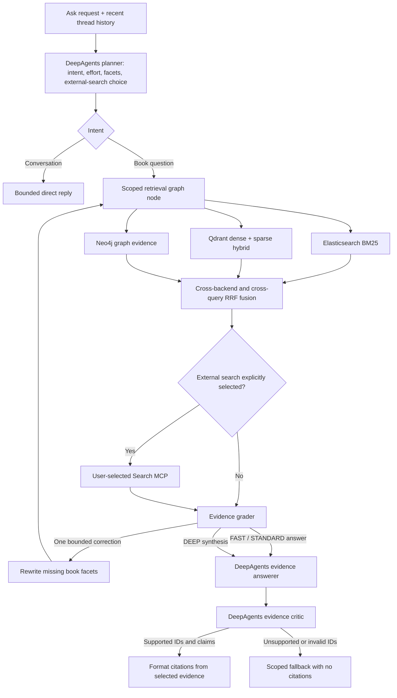

# BD Ask Adaptive Agentic RAG — architecture and implementation review (2026-11-22)

**Status:** Adaptive Ask implementation is in the working tree. This note records the YCS comparison, the FastMCP study, current upstream findings, and the next architecture decisions. No tests were run in this pass.

## Decision

Keep **LangGraph as the owner of routing, retrieval budgets, evidence flow, retries, and answer verification**. Use **DeepAgents for narrow, structured model roles that benefit from role-specific Skills**, not as the component that directly controls Elasticsearch, Qdrant, Neo4j, or the user’s MCP server.

Keep the three book stores behind the existing typed, book/run/revision-scoped services. Their contracts are more important than exposing their implementation through MCP. Use the selected external Search MCP as an optional, separately attributed evidence source. The current public `/mcp` endpoint is unauthenticated and only registers the system `ping`; it is not an appropriate place to expose book data.

This preserves the strongest pattern in YCS Ask: a deterministic graph owns the workflow, and model calls are bounded steps inside it. It also keeps BD Ask’s scope pinned to the selected book’s active ingestion index.

## What the code showed

### YCS Ask

The YCS adaptive graph in `apps/server/ai/ycs/graphs/ask/adaptive/graphs.py` routes between direct conversation, a standard retrieval pipeline, and a deep research path. The graph calls separate planning, retrieval, synthesis, and critic nodes. Standard retrieval is delegated to the existing channel-scoped retrieval workflow; deep research creates a small set of subquestions, runs bounded retrieval work, synthesizes the evidence, and verifies the result. Retrieval and backend validation remain services rather than free-form database tools.

The design lesson for BD is to carry over the **control-flow shape and evidence discipline**, while retaining BD’s stricter book/run/revision boundary. Search MCP belongs on an explicit external-evidence branch. It should not silently replace book retrieval or turn a book question into a web answer.

See the prior [YCS architecture review](YCS-AGENTIC-RAG-ARCHITECTURE-SOTA-2026-11-08.md) for its fuller retrieval and Query workbench analysis.

### Existing BD Ask and retrieval

BD Ask already had a useful LangGraph outline and direct access to all three book stores:

- Elasticsearch BM25 passages, scoped by book, ingestion run, processed revision, and index fingerprint.
- Qdrant dense plus sparse hybrid retrieval with Qdrant-side RRF.
- Neo4j entity, relationship, and graph-evidence retrieval with the same book/run/revision scope.

The main gaps were that FAST and STANDARD did nearly the same work; Ask did not have a direct conversation route; book evidence was concatenated rather than fused across backend ranks; the configured Search MCP was not an Ask evidence lane; and the DeepAgents roles did not load their Skills.

### FastMCP study folder

I reviewed the examples and READMEs under `/home/rafaelcoelho/Workbench/AIAgentsStudies/frameworks/fastmcp`, chapters `001_quickstart` through `011_auth`. The recurring patterns worth carrying into COELHO Nexus are:

- Organize MCP registration by capability, with separate `tools`, `resources`, and `prompts` modules and thin registration functions.
- Give tools typed, narrow input and output contracts; validate and bound inputs at the service boundary.
- Use request context and dependency injection for identity and service handles; do not treat caller-supplied tenant or book IDs as authority.
- Put cross-cutting concerns in middleware, but keep authorization in explicit policy checks. Tool visibility and allowlists reduce exposure; neither replaces authorization.
- Keep resource reads within a resolved, authorized path. Treat returned external text as untrusted input.
- Use in-memory FastMCP clients for future MCP boundary tests, and keep auth, scopes, lifecycle, and storage explicit.
- The study’s CodeMode and experimental skill-serving patterns are not necessary for BD Ask’s deterministic internal retrieval path.

The code progression across those chapters is useful as a practical map: `001`–`003` cover server construction, typed tools, structured results, and request context; `004`–`005` separate resources from reusable prompts; `006`–`007` deepen context injection, tool behavior, error results, and validation; `008` compares local/filesystem/custom/proxy providers, composition, transforms, and Skills; `009` covers elicitation, sampling, progress, logging, completions, and pagination; `010` demonstrates middleware, dependency injection, lifespans, storage, session state, extensions, tasks, and component versioning; `011` adds JWT/OAuth authentication, scopes, roles, tenant checks, and protected document services. A Python source inventory across all chapters confirmed the repeated separation of `domains/`, MCP-facing registration, DeepAgents construction, and MCP client adapters; the detailed security boundary is clearest in `011_auth`, while `008_mcp_providers` explains why provider selection and component transformation are separate concerns.

Two specific transfer rules follow from that code. First, `ProxyProvider` forwards incoming headers by default; a proxy configured with its own service credential should disable incoming-header forwarding unless forwarding is an intentional part of the trust model. Second, MCP elicitation and sampling are protocol interactions for a tool call; BD Ask already has a user-facing SSE stream and should continue to collect user intent in the Ask UI/graph instead of making retrieval tools ask questions or invoke a second model on the caller’s behalf. The FastMCP 4.2.2 release fixed skill discovery when server transforms are present; the current 4.2.3 line includes that correction, but the study’s 4.2.0 compatibility note is a reason to keep a skills-over-MCP integration test during any future migration.

The strongest FastMCP lesson for this feature is not “make every backend an MCP tool.” It is to make any exposed tool a narrow, authenticated contract with explicit scope and source provenance.

## BD Ask flow

Effort is bounded by the plan: **FAST** searches the original question once; **STANDARD** searches at most two facets; **DEEP** searches at most four facets and synthesizes. All facets use the same retrieval adapters. A single evidence correction is allowed. External search is only enabled when the planner marks a book-intent question as needing outside or current information; it uses the selected, tested Search MCP connection from Settings and does not block book retrieval if unavailable.

## Contracts and operating rules

### Retrieval and evidence

1. Resolve the book’s active ingestion run and processed revision before starting the graph. Lock the Ask thread to its original book.
2. Keep backend filtering server-owned. Never accept arbitrary Elasticsearch DSL, Qdrant filters, Cypher, collection names, or index names from the model.
3. Return normalized evidence records with a stable ID, exact evidence text, backend/source label, score, and citation metadata.
4. Fuse ranked lists with reciprocal rank fusion. Deduplicate normalized evidence while retaining `matched_sources` and backend score metadata for tracing.
5. Preserve an explicit origin on every record: book evidence or external search evidence. Keep those citations separately attributable in the answer.
6. Treat retrieved book and web content as untrusted evidence, not instructions. The answerer only receives bounded evidence and conversation context.
7. Citation formatting may cite only IDs returned by the answerer that exist in the current evidence packet. Do not invent a citation when the answerer supplies no valid evidence ID.

Qdrant’s hybrid query API provides dense/sparse prefetch with RRF fusion; Elasticsearch supports hybrid retrieval and RRF; Neo4j’s GraphRAG package offers hybrid and Cypher retrievers. Keep those backend-specific features inside the adapters, then fuse results again across stores at the BD evidence boundary. See the official [Qdrant hybrid query guide](https://qdrant.tech/documentation/search/hybrid-queries/), [Elasticsearch hybrid search guide](https://www.elastic.co/docs/solutions/search/hybrid-search), and [Neo4j GraphRAG for Python](https://neo4j.com/docs/neo4j-graphrag-python/current/index.html).

### DeepAgents roles, Skills, and middleware

The planner, grader, answerer, and critic each have a dedicated Skill under `apps/server/ai/bd/skills/ask/`. The Skill gives that role its operating instructions; the structured Pydantic response remains the machine contract. Skills are read-only and role-scoped.

Keep these constraints on every Ask agent:

- Disable the general-purpose subagent profile unless a measured task needs delegation.
- Provide no database, shell, write, or arbitrary web tools to the planner, grader, answerer, or critic.
- Allow only `read_file` for `/skills/**`; deny other filesystem reads and all writes.
- Use a tool allowlist and a low `ModelCallLimitMiddleware` run limit. Keep model timeouts/retries bounded in the invocation service.
- Validate every structured response with Pydantic and fail closed if parsing or evidence validation fails.
- Bound history, question text, number of facets, evidence count, evidence text, and total prompt size.

This uses DeepAgents Skills as reusable role guidance, while LangGraph remains the policy and execution boundary. DeepAgents documents Skills as loadable agent knowledge; LangGraph documents checkpointers as the mechanism for graph-state persistence. BD Ask currently persists thread history and streamed turn snapshots in its conversation store, but compiles this graph without a LangGraph checkpointer. If restart-and-resume of an in-flight Ask turn becomes a product requirement, connect the graph to the existing Postgres checkpoint lifecycle and use turn-specific checkpoint IDs; snapshots alone are not execution checkpoints. See [DeepAgents Skills](https://docs.langchain.com/oss/python/deepagents/skills) and [LangGraph persistence](https://docs.langchain.com/oss/python/langgraph/persistence).

### Search MCP boundary

The external lane reads the already validated user selection through `domains.settings.search.service.resolve_default_mcp_connection()`. It discovers the remote tool schema, selects a compatible search tool, builds arguments from that schema, normalizes HTTPS source records, and optionally reads a small number of full sources when a compatible read tool exists. Calls, results, and evidence text are bounded. If the connection, tool schema, or provider fails, book retrieval continues and the UI can report the status.

The internal Elasticsearch, Qdrant, and Neo4j calls should remain direct service calls in LangGraph. They already share the application’s identity and data scope; wrapping them in a loopback MCP hop would add serialization, lifecycle, and authorization surfaces without making retrieval more adaptive. If COELHO Nexus later exposes BD data over MCP, add a separately authenticated surface only after the caller identity can be mapped to authorized books and active revisions.

For that future MCP surface, expose a small set of purpose-built read tools such as `bd.search_book` and `bd.get_evidence`, not raw backend query languages. Resolve book/run/revision scope from authenticated server context, enforce book access inside the service, return normalized evidence IDs and citations, and mark tools read-only as protocol metadata. Authentication and authorization checks remain mandatory regardless of tool annotations or visibility. Keep `ping` separate from data tools.

The capability split should look like this:

| Capability | Owner in BD Ask | Boundary |
| --- | --- | --- |
| Book passage, hybrid-vector, and graph retrieval | LangGraph retrieval node plus `domains.bd.ask.ai.retriever` services | Direct typed calls; active book/run/revision resolved server-side |
| External web/current search | `ai.bd.nodes.ask.external_search` | MCP client from the tested Settings connection; one bounded search and optional source reads |
| Ask planning, grading, answer, and critic | LangGraph nodes invoking role-scoped DeepAgents | Structured Pydantic outputs and Skills; no backend tools |
| Future MCP consumers | FastMCP capability registration | Authenticated `bd.ask_book`, `bd.search_book`, and `bd.get_evidence` contracts reusing the same domain services |

For the future FastMCP registration, follow the repository’s capability layout, for example `entrypoints/mcp/tools/bd/ask/{schemas.py,service.py}` and a small `register(mcp)` function. Add resources or prompts only when another MCP client has a concrete need for them; do not duplicate the Ask role Skills as a second prompt catalog. Use FastMCP authentication/OAuth for caller identity, then dependency injection or request context to pass the authenticated principal into an explicit book-access policy. Add MCP middleware for request correlation, audit logging, metrics, rate limiting, and consistent error handling. Keep authorization and resource scope in the tool/domain service because middleware order, visibility filters, and read-only annotations are not an access-control model. See the official [FastMCP middleware guide](https://gofastmcp.com/docs/servers/middleware) and [authentication guide](https://gofastmcp.com/docs/deployment/auth).

## FastMCP and LangChain MCP version decision

The application currently pins FastMCP `>=3.4.10,<4` and uses `langchain-mcp-adapters>=0.3,<1`. The lock resolves FastMCP 3.4.11, `langchain-mcp-adapters` 0.3.0, LangChain 1.4.6, LangGraph 1.2.16, and DeepAgents 0.6.8. The external Search MCP lane added here uses the installed legacy adapter.

Current upstream research changes the upgrade plan:

- FastMCP **4.2.3** is the latest release observed on 2026-11-22; FastMCP 4 includes a rewritten SDK client, dependency injection, client groups, and the newer skills surface. See [FastMCP releases](https://github.com/PrefectHQ/fastmcp/releases) and [FastMCP documentation](https://gofastmcp.com/docs/servers/tools).
- `langchain-mcp-adapters` was archived on 2026-09-17. LangChain directs users to `langchain[mcp]` and `langchain.mcp.MCPAdapter`; the Python namespace currently requires LangChain 1.4+ and is documented as beta. See the [archived adapter notice](https://github.com/langchain-ai/langchain-mcp-adapters) and [current LangChain MCP guide](https://docs.langchain.com/oss/python/langchain/mcp).
- LangChain 1.5.2 was the latest release observed on 2026-11-22, while the lock resolves 1.4.6. The new MCP adapter is therefore available by version, but requires the MCP extra and FastMCP 4 client stack; it should not be imported into the current FastMCP 3 environment piecemeal. See [LangChain releases](https://github.com/langchain-ai/langchain/releases).
- The repository’s FastMCP 3 pin and current `main.py` integration are coupled to the existing server. Moving to FastMCP 4 and the first-party LangChain adapter is therefore a coordinated dependency/API migration, not a safe one-line package bump.

Keep the current lock for this implementation pass. Schedule a dedicated migration that updates FastMCP, LangChain MCP support, the mounted ASGI app, and the external client together; add MCP integration coverage for the selected provider and both existing `/mcp` and external client behavior before promoting it. Pin the resolved versions in `uv.lock`. Do not deploy the experimental FastMCP 4.2 server-side Skills to replace BD’s existing local Skills until the workflow is proven.

As of this review, official release pages show LangGraph 1.2.20 (Nov 11) and DeepAgents 0.7.41 (Nov 20). The lock is behind each latest release, even though the application constraints allow those major/minor lines. Verify compatibility and run the project’s required checks before raising minimums. See [LangGraph releases](https://github.com/langchain-ai/langgraph/releases) and [DeepAgents releases](https://github.com/langchain-ai/deepagents/releases).

## Implementation in this working tree

- Added direct conversation routing, explicit FAST/STANDARD/DEEP query budgets, and typed external-search intent to the BD Ask LangGraph.
- Added the optional Settings-selected Search MCP evidence lane, with bounded discovery/search/read operations and independent external-source attribution.
- Added cross-query and cross-backend RRF fusion while preserving source provenance.
- Wired four role Skills to the DeepAgents Ask roles, with read-only Skill access and bounded model/tool middleware.
- Tightened answer verification and citation formatting so invalid or missing evidence IDs do not produce apparently grounded citations.
- Added turn and graph-stage stream metadata for conversation route and external-search status.

## Evaluation before rollout

Build a BD book-QA evaluation set with questions labeled for intent, expected evidence passages/pages, acceptable facets, and whether current external evidence is needed. Compare FAST, STANDARD, and DEEP on answer correctness, completeness, groundedness, citation precision/recall, abstention quality, latency, token cost, and retrieval success by backend. Include follow-ups, ambiguous questions, questions absent from the book, contradictory external sources, and Settings cases where Search MCP is unavailable or returns malformed/no results.

Track retrieval Recall@k/MRR/nDCG for each backend and the fused packet; track answer faithfulness and citation validity separately from fluency. Use trace spans for planner, each backend, external MCP, grade, answer, critic, and citation formatter. Promote changes only after quality and latency are compared against the current BD Ask route on the same examples. No evaluation or automated tests were run for this pass.
