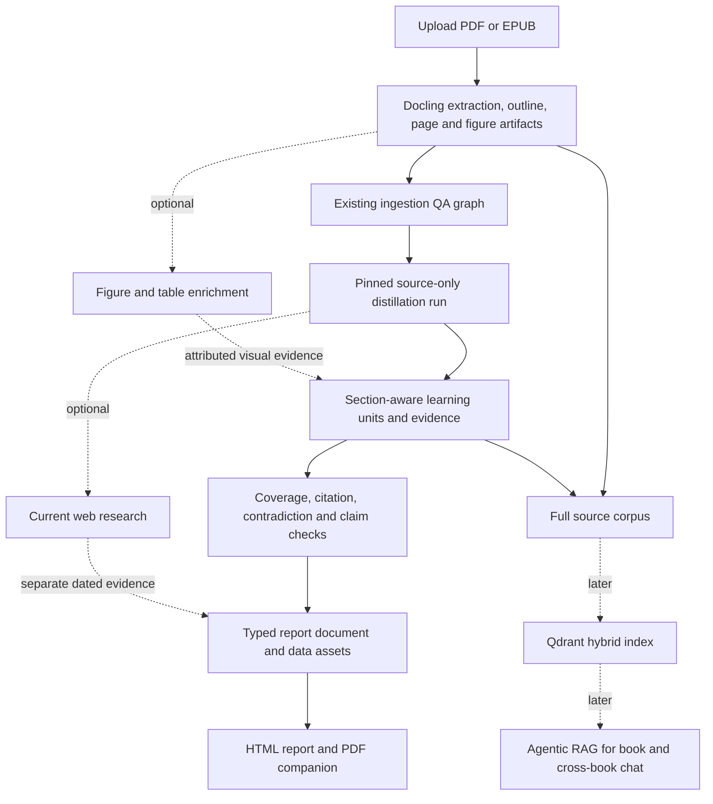

# Book Distiller: Distill feature, learning report, visuals, and later RAG

**Status:** Product and architecture reference. The source-only Distill workflow, selection review, Settings connections, reader UI, and post-publication Qdrant indexing lifecycle are implemented; human evaluation, live research, and RAG chat remain later stages. See §12 for current status. Use it with the existing [Book Distiller product decision](BOOK-RESEARCH-FEATURE-SOTA-2026-10-30.md), [ingestion architecture](BD-INGESTION-AGENTIC-AI-ARCHITECTURE-2026-11-03.md), and [ingestion agent SOTA review](BD-INGESTION-AGENTIC-AI-SOTA-2026-11-06.md).

**Research snapshot:** 2026-11-06. Recheck framework, renderer, and visualization versions before upgrades or implementing external research.

## 1. Product objective

Book Distiller should help a reader learn a book's important ideas in less time, retain the supporting explanations and caveats, and apply the ideas more effectively. The experience is:

> Upload a book → prepare and verify its extracted source → distill evidence-backed learning material → read a shorter, navigable report → inspect original pages when needed → later ask cited questions across one or more books.

Treat “learn everything from the book without losing learning quality” as the product goal to measure, not as a guarantee made by a summarizer. The report should preserve broad chapter coverage, source traceability, enough explanation to teach the ideas, and practice material. Measure whether readers understand, recall, and apply the content; a lower page count alone is not a success metric.

The report is a first-class product artifact. It can include structured lessons, examples, datasets, charts, equations, diagrams, decision aids, and exercises in addition to prose. Agents should produce these as validated content objects; trusted code should assemble and render them.

## 2. What the repository has today

BD now has source preparation/ingestion QA, a source-only Learning Guide workflow, and a separately queued post-publication Qdrant index. The web product includes selection review, Distill run controls, report reading, and retrieval-index status. The source-only workflow has not yet passed human learning-outcome evaluation.

| Area | Current capability and relevant code |
|---|---|
| Upload and extraction | PDF/EPUB dispatch, retries/resume, page-slice extraction, object storage, and optional automatic chaining are in [`dispatch/service.py`](../apps/server/domains/bd/ingestion/runtime/dispatch/service.py). The current page limit is 3,000. |
| Outline | PDF bookmarks and extracted headings produce an outline and page `section_path`; see [`outline/domain.py`](../apps/server/domains/bd/ingestion/outline/domain.py). |
| Structured documents | Docling output, page Markdown, figures, and manifests are persisted. OCR and vision-based image/chart enrichment are configurable but currently off by default in [`extract/config.py`](../apps/server/domains/bd/ingestion/extract/config.py). |
| Ingestion Agentic AI run | Run identity is pinned to an extraction run and its manifest hash in [`ai/service.py`](../apps/server/domains/bd/ingestion/ai/service.py) and [`ai/schemas.py`](../apps/server/domains/bd/ingestion/ai/schemas.py). |
| Ingestion graph | The five sequential stages are `audit_batch → plan_repairs → repair_pages → normalize_metadata → publish` in [`graphs.py`](../apps/server/ai/bd/graphs/ingestion/graphs.py), with typed graph state in [`states.py`](../apps/server/ai/bd/graphs/ingestion/states.py). Agents audit extracted pages and propose bounded repairs; deterministic checks control routing, patch safety, hashes, and publication. |
| Publication | The current publish stage checks page artifacts and text-loss indicators and writes a quality report; see [`publish/service.py`](../apps/server/ai/bd/nodes/ingestion/publish/service.py). This is not a learning-fidelity or educational-outcome evaluation. |
| Distill | A separate run pins the extraction and QA manifests, extracts and verifies learning units, synthesizes chapters/book, and publishes JSON and HTML. See [`distill/service.py`](../apps/server/domains/bd/distill/service.py) and [`distill/router.py`](../apps/server/entrypoints/api/v1/bd/distill/router.py). Structural citation and coverage checks are recorded; a human-reviewed gold set is still needed. |
| Report formats | Static, script-free HTML is stored with the report. Print-ready CSS and an on-demand PDF endpoint use the isolated headless Chromium service when `PLAYWRIGHT_CDP_HEADLESS` is configured. |
| API/UI | The BD UI exposes upload, Ingestion run controls, source-page review, Distill run lifecycle/progress, Learning Guide reading and downloads, and content-selection review. Search MCP provider connections and retrieval-index status/retry are available in Settings and the report view. |
| Retrieval infrastructure | A separate post-publication task builds a resumable hybrid Qdrant index over all normalized Ingestion pages, validated learning units, and the published Learning Guide. Elasticsearch/Neo4j clients remain unused by Distill; no retrieval query or cross-book chat interface is included yet. |

The existing source manifests, hashes, chapter paths, figures, immutable storage, progress events, and graph checkpointing should be reused. The current extraction request passed to the graph includes ordered page references, but does not itself carry all outline context; the new distillation run must load and pin the appropriate outline/section data from the extraction artifacts.

**Scale finding:** page work currently runs in batches inside graph nodes. Progress events do not make every individual model result a durable graph checkpoint. For book-length distillation, make each bounded section/chapter unit restartable and idempotent, write completed artifacts outside graph state, and keep graph state to references and compact metadata. LangGraph documents fan-out with `Send` and persistence/task patterns for isolating durable work ([graph API](https://docs.langchain.com/oss/python/langgraph/graph-api), [persistence](https://docs.langchain.com/oss/python/langgraph/persistence)).

## 3. Target architecture

Keep ingestion QA, book distillation, optional current-web research, report rendering, and future question answering as separately versioned stages. A distillation rerun should not require re-uploading or re-extracting the source.

### Distill graph stages

1. **Validate and pin input.** Require a completed extraction and the intended ingestion QA run. Pin book ID, extraction/run IDs, hashes for source and outline manifests, page count, workflow/schema/prompt versions, models, optional web-research date, and output renderer versions.
2. **Build the reading hierarchy.** Use the existing TOC/headings and `section_path`. Repair missing hierarchy only through a bounded, verifiable step. Preserve physical page identity, and represent front matter, appendices, unassigned pages, and image-only pages explicitly.
3. **Create bounded content units.** Split long sections into context-sized units while preserving heading breadcrumbs, page boundaries, tables, and nearby figure references. Do not treat physical pages as the only semantic unit.
4. **Extract learning units in parallel.** Use fixed, typed work roles for claims, concepts, definitions, procedures, evidence, examples, caveats, and actions. Use bounded LangGraph fan-out over known units; DeepAgents can provide specialist context/tooling where useful. Avoid one dynamically spawned agent per page.
5. **Verify local coverage and evidence.** Check source locators deterministically; ask a verifier whether the cited span supports the claim; preserve unresolved findings as uncertain/review-required. Record what was omitted or could not be read rather than silently filling gaps.
6. **Synthesize across sections.** Assemble chapter guides from learning units, then identify supported cross-chapter connections, dependencies, repeated ideas, and contradictions. Avoid “summary of summaries” as the only evidence path: synthesis must retain links to the underlying source units.
7. **Add optional figure and web evidence.** Figure descriptions, formulas, and chart tables can be enriched using a vision model after source-only extraction quality is measured. Web research is a separate branch with source URL, source type, publication/access date, and evidence; it must not silently alter what the book says.
8. **Build, check, and publish the report.** Compose a `StudyGuideDocument`, run schema/citation/coverage/asset checks, render outputs, then publish a versioned report manifest last. Keep incomplete runs separate from the active report.

LangGraph should own the predictable workflow and durable checkpoints. Agents should make bounded judgments inside stages. Deterministic code should own routing where rules are known, schemas, citation resolution, data transformations, safe file handling, and publication invariants. DeepAgents' skills/subagents can support specialized tasks; they do not replace graph-level state, retries, and run identity. See [DeepAgents overview](https://docs.langchain.com/oss/python/deepagents/overview) and [subagents](https://docs.langchain.com/oss/python/deepagents/subagents).

## 4. Canonical artifact model

Persist a typed, versioned intermediate representation instead of making generated Markdown, LaTeX, Python, or HTML the source of truth. Pydantic schemas fit external/agent boundaries; graph state should contain compact `TypedDict` state and references, following existing server conventions.

### `DistillRunManifest`

Pin at least:

- `book_id`, extraction run ID, ingestion QA run ID, expected page count, outline key/hash, source manifest key/hash;
- run ID, status, timestamps, progress and errors;
- workflow and schema versions, prompts/skills, model/provider settings, relevant decoding limits;
- optional web research mode, access time, and evidence bundle version;
- report document, chapter artifact, dataset, figure, and rendered output keys with checksums;
- evaluation results and review status.

This makes reruns comparable and prevents a report from accidentally mixing pages from different extraction candidates.

### `SourceRef` and `LearningUnit`

Every substantive book-derived item should be traceable to one or more stable source references. A source reference should carry a source class (`book`, `web`, `agent_inference`), book/run identity, page number, section path, stable chunk/span ID, source hash, and a resolvable storage locator. Keep short supporting spans where appropriate; the page remains the canonical inspection destination.

A learning unit should include:

- stable unit ID and kind (`principle`, `definition`, `method`, `example`, `fact`, `caveat`, `action`, etc.);
- concise claim plus enough explanation to teach it;
- author/book claim versus system inference attribution;
- evidence references, confidence/uncertainty, and validation/review status;
- relations to concepts, prerequisites, and other learning units.

### `StudyGuideDocument` and visual assets

The document contains ordered sections and typed blocks such as `Lesson`, `Definition`, `Procedure`, `WorkedExample`, `DecisionTable`, `Equation`, `Chart`, `Diagram`, `Timeline`, `Glossary`, `Exercise`, `Caveat`, and `Citation`. A block holds content and references; it does not contain arbitrary renderer code.

Store chart data separately from chart appearance. A `Dataset` should describe columns, types, units, observations, row/cell provenance where feasible, transformations, assumptions, and confidence. A `ChartSpec` references that dataset and declares a chart type, encodings, labels, caption, accessible description, and source references. A `DiagramSpec` should have typed nodes and typed, evidence-linked edges; label relations accurately (for example, distinguish “causes” from “is associated with”). An `EquationBlock` should include LaTeX expression, symbol definitions, units, assumptions, worked example/derivation when warranted, and evidence.

## 5. Recommended reader-facing report

Use progressive depth so a reader can orient quickly without losing access to the book's substance:

1. **Book and report scope:** book metadata, edition/source, report depth, processing run, extraction limitations, and how to inspect citations.
2. **Quick orientation:** central thesis, key takeaways, and a learning map.
3. **Chapter-by-chapter guide:** the question/problem, core ideas, reasoning, examples, caveats, and actions for each chapter.
4. **Whole-book synthesis:** frameworks, dependencies, tensions, recurring concepts, and what conclusions depend on earlier chapters.
5. **Decision and practice aids:** comparison tables, procedures, decision trees, and application playbooks with assumptions and constraints.
6. **Reference section:** glossary, equations, structured data/figures, recall questions, and source index.
7. **Optional current context:** separately marked external research with dated primary sources and explicit links back to the book topics.

Every fact or recommendation attributed to the book should link to book evidence. Mark an inference as an inference. Mark web context as external and dated. Preserve disagreement between the book and external evidence rather than blending the sources into a single unattributed narrative.

### Visual selection rules

| Structure | Use it for | Required evidence/data |
|---|---|---|
| Comparison/decision table | Comparing methods, choices, criteria, benefits, risks | Source reference per meaningful row or cell; explicit criteria and units |
| Bar/line/scatter/distribution chart | Numeric quantities, time trends, comparisons, relationships | Validated values, units, transformations, assumptions, source references, accessible summary and data table |
| Flowchart/decision tree | A process, ordered method, or conditional choice described in the book | Evidence for steps, conditions, and outcomes; preserve uncertainty and exceptions |
| Concept map/graph | Concepts and their relationships across sections or books | Typed relation (`defines`, `requires`, `supports`, etc.) with evidence per important edge |
| Timeline | Events or dated developments where order is meaningful | Dates/events, source locators, uncertainty for approximate dates |
| Equation | Mathematical relationship or model | LaTeX, symbol/unit definitions, assumptions, cited derivation or source |
| Worked example | Applying an idea or formula to a concrete case | Inputs, steps, result, assumptions, and distinction between book example and generated example |

Use a chart only when there is a dataset or a clearly identified conceptual structure. Do not invent numeric values to make a visual. Charts and diagrams need a useful text alternative; provide their data in a table when practical, consistent with [W3C WCAG guidance](https://www.w3.org/WAI/WCAG22/Understanding/non-text-content.html).

## 6. Report formats and rendering tools

**Default:** interactive HTML report in BD, plus a print-ready PDF download. HTML supports linked page citations, interactive charts, navigation, search, and expandable depth. PDF is valuable for offline reading and printing, but interactive charts become static images.

Generate both outputs from the same validated report model. Quarto is a practical rendering option for a long-form publication: it supports multiple output formats, Mermaid/Graphviz, and PDF through Typst or LaTeX. Prefer Typst for the initial PDF path when its typography/features meet the report requirements; use LaTeX for a specific math, publisher, or typesetting requirement. Keep LaTeX as the equation notation even if the overall document uses another renderer. Do not allow the agent to write arbitrary raw TeX/HTML into the document model.

| Tool/format | Version snapshot as of 2026-11-06 | Recommendation and trade-off |
|---|---|---|
| Quarto | 1.11.9 latest stable, 2026-10-30; 1.12.0 is marked prerelease, 2026-11-02 | Good candidate for long-form HTML/PDF generation with a shared source. Pin the stable release and use a controlled render worker. [Releases](https://github.com/quarto-dev/quarto-cli/releases), [Typst PDF](https://quarto.org/docs/output-formats/typst.html). |
| Plotly.py | 7.1.0, 2026-09-15 | Pragmatic Python chart path for interactive HTML and static export. Static image rendering requires Kaleido and Chrome, which must be present in the renderer image. [Releases](https://github.com/plotly/plotly.py/releases), [figure data](https://plotly.com/python/figure-structure/), [static export](https://plotly.com/python/static-image-export/). |
| Vega-Lite | 6.5.0, 2026-10-08 | Declarative JSON grammar for common charts; narrower and easier to constrain than arbitrary plotting code. Consider if strict chart-spec validation and portability matter more than Plotly's Python convenience. [Docs](https://vega.github.io/vega-lite/docs/), [releases](https://github.com/vega/vega-lite/releases). |
| Mermaid | 12.2.0, 2026-10-13 | Compact text syntax for flowcharts and other supported diagram types. Keep strict security settings and validate/render generated diagrams before publication. [Releases](https://github.com/mermaid-js/mermaid/releases), [security levels](https://mermaid.js.org/config/schema-docs/config-properties-securitylevel.html). |

The exact version set is a research snapshot, not a lockfile recommendation. Check compatibility and support dates before implementation; pin Quarto, Mermaid, Plotly/Kaleido/Chrome, and any PDF fonts/renderers in the build image.

## 7. Generated code and sandbox boundary

Schema-first generation should handle the common case: agents return a dataset, chart specification, equation, or diagram structure; trusted renderers build the asset. Permit generated Python only when it adds measured value, such as a calculation that cannot be expressed by an existing transformation or a specialized plot.

Treat generated code and all book/web content as untrusted. A code-render job should be ephemeral, isolated from application credentials and host files, non-root, default-deny for network egress, limited to preinstalled packages, and bounded by CPU, memory, process, file-size, and wall-clock limits. Provide source assets read-only and a separate output location. Do not let code install arbitrary packages, access the database/object store directly, or call external tools. Validate output paths, MIME types, size, dimensions, and active content before storing or serving artifacts; sanitize SVG/HTML and reject unexpected files. Official sandbox guidance also warns against relaxing egress, mounting secret-bearing paths, or passing credentials to untrusted code ([Cloud Run code-execution security boundaries](https://docs.cloud.google.com/run/docs/code-execution)).

The report renderer should consume typed blocks and validated assets, not execute scripts or code embedded in the uploaded book. Mermaid should remain at its documented strict security setting for user-visible generated diagrams.

## 8. Later Agentic RAG architecture

Do not build chat by indexing only the compressed report. Keep the original extracted pages as the complete source and index them alongside the validated learning units, section/chapter context, and report blocks. This lets chat answer details intentionally omitted from the short guide.

Start with Qdrant for BD because shared Qdrant infrastructure already exists. Use a rebuildable hybrid index combining lexical/BM25 and dense semantic retrieval, with metadata for book, extraction run, page, section, source type, and chunk level. Use a parent-child hierarchy: retrieve precise page/section passages, then open their parent section or chapter for context. Add an agent loop with bounded tools such as `search_book`, `read_source`, `read_section`, and `find_related_concepts`; verify that answer citations resolve to retrieved material before returning an answer.

Offer explicit modes: one book, selected books/corpus, and optionally current web context. Keep web citations distinct from book citations. Add reranking or graph traversal only when retrieval evaluations show a specific failure they solve.

| Store | Repository/current snapshot | Decision |
|---|---|---|
| Qdrant | Existing infra; lock resolves client 1.16.1. Official client/server 1.20.0 released 2026-10-22; v1.20 adds BM25 scoring on full-text payload indexes. | Recommended first retrieval index. Confirm client/server compatibility and evaluate the existing sparse-vector route before adopting new BM25 functionality. [Client](https://pypi.org/project/qdrant-client/), [server releases](https://github.com/qdrant/qdrant/releases), [hybrid queries](https://qdrant.tech/documentation/hybrid-queries/). |
| Elasticsearch | Project allows `<9`, lock resolves 8.19.3; official Elastic release is 9.5.6 (2026-11-02). Existing `infra/elasticsearch/schemas.py` marks two indexes deprecated. | Do not add as a second BD index by default. Reconsider if the team chooses to upgrade and operate Elastic for a concrete search requirement. [Downloads/releases](https://www.elastic.co/downloads/elasticsearch), [local schemas](../apps/server/infra/elasticsearch/schemas.py). |
| Neo4j | Existing driver lock 5.28.4 and project cap `<6`; latest official Python driver 6.4.1 (2026-10-15). | Defer until measured multi-hop/cross-book concept questions benefit from graph traversals. A knowledge graph adds extraction, consistency, and maintenance work; it does not automatically improve retrieval. [Driver releases](https://github.com/neo4j/neo4j-python-driver/releases). |

The repository lock also resolves LangGraph 1.2.16 and DeepAgents 0.6.8, while current official releases are LangGraph 1.2.20 and DeepAgents 0.7.34 (both 2026-11-05). Upgrade independently of the initial distillation implementation, pin versions, and regression-check the existing agent factories—especially code that depends on private framework attributes. [LangGraph releases](https://github.com/langchain-ai/langgraph/releases), [DeepAgents changelog](https://github.com/langchain-ai/deepagents/blob/main/libs/deepagents/CHANGELOG.md).

## 9. Evaluation and promotion gates

Create a human-reviewed gold set before optimizing agents. Use several representative books, varied in structure and content, and prepare chapter-level facts, citations, and questions. A single book or a single whole-book summary score is not adequate.

Measure at least:

1. **Coverage and omission:** important lessons represented across chapters, including middle and late sections; explicit accounting for unprocessed or unreadable source material.
2. **Evidence quality:** source locator resolves; cited span supports the claim; unsupported or over-generalized claims; attribution errors between book claims, web facts, and model inference.
3. **Synthesis quality:** correct cross-chapter relationships, preserved disagreement, no false causal edges, and useful caveats.
4. **Visual correctness:** chart values reproduce from the stored dataset/transformation; equation assumptions and calculations check; diagram edges map to evidence; PDF/HTML assets render consistently.
5. **Learning utility:** comprehension, immediate and delayed recall, transfer/application questions, reading time, reader confidence, and ability to find supporting passages.
6. **Operations:** token/model cost, latency, retry/resume correctness, duplicate work, artifact integrity, and failure/review rates.

Use deterministic tests for invariants and citation resolution, plus human review and calibrated model graders for semantic support. Do not use an LLM judge as the sole quality gate. Long-form summarization research reports positional/coverage issues and limitations in automatic faithfulness evaluation; evaluation should deliberately include evidence from across the whole book ([NAACL 2025 long-form faithfulness study](https://aclanthology.org/2025.naacl-long.442/), [ICLR 2024 book-length summary evaluation](https://openreview.net/pdf?id=7Ttk3RzDeu), [EMNLP 2025 evidence-span study](https://aclanthology.org/2025.emnlp-main.95/)).

Promote a report only when its source manifest is complete, required citations resolve, no critical coverage or grounding failures remain, and the output renderer has successfully produced the required formats. Preserve lower-confidence claims and review flags in the artifact rather than silently dropping them.

## 10. Recommended implementation sequence

1. **Define the report contract and evaluation set.** Decide report depths, block types, citation identity, attribution labels, and measurable learning outcomes. Build a small gold set with human-checked chapter coverage and questions.
2. **Add a separate Distill run and schemas.** Introduce the manifest, `SourceRef`, `LearningUnit`, `Dataset`, `VisualSpec`, and `StudyGuideDocument`. Pin it to existing extraction and ingestion-QA runs.
3. **Build a source-only pilot graph.** Outline → bounded section units → parallel learning extraction → evidence/coverage checks → chapter and book synthesis → report model. Persist each unit/chapter as an immutable artifact and make retries idempotent.
4. **Render the first report.** Start with cited prose, tables, glossary, and exercises. Deliver interactive HTML and a printable PDF from the same validated document. Evaluate on 2–3 varied pilot books and revise the schema/report depth based on evidence.
5. **Add visual enrichment.** Introduce validated datasets/charts, sourced diagrams, equations, and selected VLM analysis of figures. Add render and accessibility checks.
6. **Add optional current research.** Give a dedicated, bounded web-research step a clear source policy. Display its dated evidence separately from the book-derived guide.
7. **Index and add RAG chat.** Build Qdrant hybrid retrieval over original source units plus derived records; evaluate citations and cross-book synthesis before introducing Neo4j or more infrastructure.

This sequence prioritizes a demonstrably useful book-learning report before optional web augmentation and cross-book chat. It keeps the later RAG system grounded in the same source references and learning records.

## 11. Research references

- LangGraph [graph API](https://docs.langchain.com/oss/python/langgraph/graph-api) and [persistence](https://docs.langchain.com/oss/python/langgraph/persistence).
- DeepAgents [overview](https://docs.langchain.com/oss/python/deepagents/overview) and [subagents](https://docs.langchain.com/oss/python/deepagents/subagents).
- Docling [vision model enrichment](https://docling-project.github.io/docling/usage/vision_models/).
- Quarto [multi-format documents](https://quarto.org/docs/output-formats/html-multi-format.html), [diagrams](https://quarto.org/docs/authoring/diagrams.html), [PDF engines](https://quarto.org/docs/output-formats/pdf-engine), and [release history](https://github.com/quarto-dev/quarto-cli/releases).
- Plotly [figure JSON structure](https://plotly.com/python/figure-structure/) and [static export](https://plotly.com/python/static-image-export/); Vega-Lite [JSON grammar](https://vega.github.io/vega-lite/docs/); Mermaid [security levels](https://mermaid.js.org/config/schema-docs/config-properties-securitylevel.html).
- W3C [WCAG non-text content guidance](https://www.w3.org/WAI/WCAG22/Understanding/non-text-content.html).
- Google Cloud [sandbox execution boundaries](https://docs.cloud.google.com/run/docs/code-execution) as one official reference for isolating untrusted code; this is not a platform selection for Nexus.
- Long-form summarization studies: [NAACL 2025](https://aclanthology.org/2025.naacl-long.442/), [ICLR 2024](https://openreview.net/pdf?id=7Ttk3RzDeu), [EMNLP 2025](https://aclanthology.org/2025.emnlp-main.95/).

## 12. Implementation status — 2026-11-08

The product name remains **Book Distiller**. Its BD feature is **Distill**, and its reader-facing artifact is a **Learning Guide**.

The server has a source-only Distill workflow. It requires completed extraction and Ingestion QA, pins each run to immutable source, QA, and content-selection manifests, extracts typed learning units from selected content, checks quotations and evidence, synthesizes chapter/appendix guides and a whole-book Learning Guide, and stores JSON plus static HTML. Runs have queued/running/done/failed/cancelled lifecycle, progress events, cooperative cancellation, persisted resumable artifacts, and a LangGraph checkpointer. The report includes physical-page citations, selected/excluded scope, coverage, a glossary, recall questions, sourced diagrams and equations, and schema-validated chart datasets with accessible renderings. Reports remain marked for human review because a representative human-reviewed evaluation set has not yet been established.

Ingestion now classifies page content and publishes immutable selection revisions. Reviewers can append inclusion overrides with revision-conflict protection; source pages remain preserved. Distill pins the chosen selection, while the Pages view defaults to retained content and can reveal excluded originals.

The BD web product includes Distill lifecycle controls, report/HTML/PDF reading, selection review, and a separate retrieval-index status/retry panel. Settings supports tested COELHO Search MCP, Tavily, Exa, and Jina connections with server-side write-only credentials. Provider API-key authentication is implemented; browser OAuth setup is not. Tavily and Jina require saved API keys before a successful connection test, while Exa supports its public keyless path. Search connections are not yet invoked by Distill; the source-only workflow remains the required baseline before adding current-web research.

After Learning Guide publication, a separate Celery job can index every normalized Ingestion page (including excluded pages), persisted learning units, and validated Learning Guide records into a model-versioned hybrid Qdrant collection. Index progress, failure, retry, and wipe are separate from report publication. No RAG query or cross-book chat layer exists yet.

Core implementation entry points are the [Distill run contract](../apps/server/domains/bd/distill/schemas.py), [run lifecycle](../apps/server/domains/bd/distill/service.py), [Distill graph](../apps/server/ai/bd/graphs/distill/graphs.py), [report publisher](../apps/server/ai/bd/nodes/distill/publish_report/service.py), and [HTTP router](../apps/server/entrypoints/api/v1/bd/distill/router.py).

The following product and rollout stages remain:

1. Provide representative human-reviewed books and complete evaluation through [`evaluate_bd_learning_guide.py`](../scripts/server/evaluate_bd_learning_guide.py). Measure coverage, citation support, comprehension, delayed recall, transfer, reading time, costs, and classifier false exclusions before making learning-quality claims.
2. Validate long report rendering and PDF download behavior against the deployed headless Chromium service, including page breaks, source links, and accessibility.
3. After the source-only guide passes evaluation, add an optional, separately versioned dated-research stage using one selected Search MCP provider. Preserve provenance and keep external evidence distinct from book-derived claims.
4. Add retrieval query tools and a user-scoped, cited one-book chat experience over the indexed corpus. Evaluate it before expanding to cross-book chat or adding Neo4j/Elasticsearch.

The Distill graph does not execute agent-generated code or run live web research. Charts and diagrams use constrained schemas and trusted static renderers. Keep code execution deferred until a concrete report use case and an isolated runtime are available. No Distill or RAG processing job was run while implementing this structure; execution remains controlled by the deployment feature flag.

## 13. Architecture update — 2026-11-08

The next architecture increment should make Distill explicitly **structure-first and evidence-first**: classify the book's content and hierarchy during source preparation, distill actual chapters and appendices as separate work units, and retain the full extracted book as the evidence corpus. The goal is to produce a shorter learning guide that preserves important teaching content and supports decisions; “learn everything without losing quality” remains an outcome to establish through paired evaluation, not a guarantee.

### Select the Distill working set after book-wide classification

Yes: pages confidently classified as irrelevant should be removed from Distill's active working set, so they do not generate learning units or influence the chapter/book synthesis. Make that selection from a book-wide content map produced after extraction and QA, not by deleting source files. Classify pages or source spans by a stable role such as `body`, `appendix`, `exercise`, `glossary`, `references`, `index`, `front_matter`, `table_of_contents`, `blank`, or `image_only`; record a separate Distill policy such as `include_primary`, `supporting_only`, `exclude_from_synthesis`, or `review_required`, with confidence and a short reason. The exact enums should be versioned in the ingestion contract.

Preserve every canonical source page and its hash; “remove” means exclude from this Distill run's inputs and synthesis, not erase the extracted source. A glossary, case study, bibliography, or appendix can be important for a particular book, so do not exclude solely by role. Use deterministic signals (outline, headings, page features, existing QA dispositions) first; have a bounded book-level classifier reconcile candidate labels with the outline and neighboring pages. Exclude only high-confidence irrelevant material. Route low-confidence or conflicting labels to review (or conservatively include them), and keep supporting-only material available as secondary evidence. Publish a versioned selection manifest with all page decisions, confidence, rationale, and source hashes.

**Pages tab behavior:** Ingestion's source Pages view remains a complete, page-ordered view of extracted originals with role/policy badges and filters, so excluded material can still be inspected. Add a Distill selection view that defaults to only the retained primary content, with a clear “Show supporting/excluded pages” control and reasons for each exclusion. Filtering never renumbers physical pages: citations and source links always use original book page numbers. This follows the current source Pages view, which builds rows from the extraction manifest and overlays QA flags in [`book-view.tsx`](../apps/web/src/features/bd/components/book-view.tsx) and [`pages.ts`](../apps/web/src/features/bd/domain/pages.ts).

Freeze this selection before creating Distill learning units. Build the selected outline and chapter work plan from that exact set, then synthesize the report from those selected units. If a page decision changes, create a new selection version/run (or invalidate every dependent artifact) and regenerate affected chapter and book synthesis; never patch the old whole-book summary while leaving its prior evidence set attached. Report both physical-page totals and selected-content coverage, and sample excluded pages during evaluation to measure false exclusions and missed important ideas.

This extends the current ingestion contract: `delivery_disposition` presently covers `include`, `discarded_blank`, and `image_only` in [`IngestionAIPage`](../apps/server/domains/bd/ingestion/ai/schemas.py). The current Distill planner skips blank pages but otherwise chunks the normalized pages in [`prepare_units`](../apps/server/ai/bd/nodes/distill/extract_learning_units/service.py). The new map should preserve that safe source behavior while adding content roles and explicit synthesis policy.

### Distill by book structure

Build stable `Part` / `Chapter` / `Appendix` / `Section` records from the pinned outline and page `section_path`, including page ranges, parent IDs, ordering, selected source spans, and unresolved hierarchy. Use those records to create chapter and appendix jobs. Do not infer a chapter merely from a repeated heading path or a fixed number of learning units. The present `prepare_chapters` groups by exact `section_path` and batches eight units; a long chapter can therefore become several generic “continued” reports, while heading fragments may be mistaken for separate chapters. Replace that grouping with an explicit hierarchy-aware planner.

Each chapter or appendix job should carry compact source references and produce an immutable, resumable artifact containing: the chapter's purpose/question; key ideas, methods, definitions, examples, evidence and caveats; decisions or actions the content supports; unresolved or omitted material; and recall/application questions. Claims and visual elements must refer back to source evidence. Then synthesize the whole book from these chapter artifacts while retaining links to the original learning units and source pages.

### Retrieval, research, and report assets

- **Distinguish Distill retrieval from the later RAG product.** The source-only Distill graph does not need a vector index to begin. It can read selected chapter spans and page artifacts directly from the pinned source objects, then preserve exact page/span citations through extraction and synthesis. If quality evaluation later shows a need to find supporting evidence across distant sections, add a bounded Distill-time retrieval tool as a separate enhancement. That retrieval is an internal aid to report production, not the post-Distill Agentic RAG corpus.
- **Post-Distill Agentic RAG indexing:** treat indexing as a separate, resumable post-publication process. After a Learning Guide passes its publication gate, enqueue indexing over *all* canonical source pages (including material marked supporting-only or excluded from synthesis) plus validated learning units and the final guide. Keep content-role/policy metadata so chat can filter or prioritize without losing source access. A failed index must not invalidate or block the already-published guide; report index readiness separately. Start with versioned, rebuildable Qdrant hybrid retrieval and keep MinIO/manifests authoritative. Apply server-side book/run access filters on every operation. See Qdrant [hybrid query](https://qdrant.tech/documentation/hybrid-queries/) and [multitenancy](https://qdrant.tech/documentation/manage-data/multitenancy/) guidance; tenant payloads do not replace application authorization.
- **Do not start with three databases.** Use Qdrant first for hybrid passage retrieval. Add Neo4j only if measured cross-chapter or cross-book relationship questions need graph traversal; add Elasticsearch only for a concrete lexical/search requirement that the selected retrieval stack does not satisfy. The existing adapters are infrastructure, not a reason to operate three synchronized indexes. See the [Neo4j GraphRAG documentation](https://neo4j.com/docs/neo4j-graphrag-python/current/) and [Elasticsearch hybrid search](https://www.elastic.co/docs/solutions/search/hybrid-search) when those decisions are revisited.
- **External research:** establish and evaluate a book-only guide first. Then add a separately versioned research stage using the future COELHO Search MCP integration. Research findings must retain URL, retrieved/published dates when available, source identity, query/topic, and the book claims they corroborate, update, contradict, or contextualize. Display them in a clearly separate report section; never rewrite what the book said as if it were current external fact. Restrict MCP tools to the user's authorized research scope and bounded search/fetch operations.
- **Search provider selection:** make the connected search provider configurable in Settings and selectable per Distill run. Use a normalized BD research interface while keeping a provider adapter for each MCP server's real tool names and authentication. Select one primary provider per run; do not expose every connected provider to the agent or silently fan out queries across providers. A deliberate fallback can be added later with explicit quota and provenance handling.
- **Visuals and code:** keep agent output in typed data structures: evidence-linked Mermaid-compatible diagrams, equations with symbols/units/assumptions, and chart specifications over validated datasets. Reuse the existing deterministic report renderers. Permit generated code only for a demonstrated calculation or visual that cannot be expressed with the typed formats, and then only in a separately isolated, resource-limited, default-deny sandbox. Do not execute arbitrary code inside the report renderer or expose shell/network tools to the book-reading agents.
- **Agent boundaries:** let LangGraph own run identity, parallel chapter work, checkpoints, retries, review gates, and publication. Use DeepAgents only for bounded judgment or specialist tasks that benefit from scoped tools/context; skills and prompts should be versioned with the run. Do not create one autonomous agent per page or let an agent choose unrestricted book/object-store paths.

### Current implementation facts that shape the work

- The source-only Distill graph is `prepare_units → extract_unit → prepare_chapters → synthesize_chapter → synthesize_book → publish_report` in [`graphs.py`](../apps/server/ai/bd/graphs/distill/graphs.py), with `Send` fan-out for learning units and chapter batches.
- Its run already pins extraction and ingestion-QA manifests, persists source chunks and artifacts, checks source hashes/citations, and publishes JSON plus static HTML. The report model already has structured learning content, equations, diagrams, datasets, and rendered charts; expand it only where the new chapter workflow needs a missing field.
- Post-publication Distill indexing is implemented with Qdrant; the retrieval query, authorization-aware chat, and live web research stages are not. The YCS RAG service's Parallel MCP fallback in [`service.py`](../apps/server/domains/ycs/rag/service.py) remains separate from BD's configurable Search MCP connections.
- The Settings page includes Search MCP provider connections in addition to LLM and embedding configuration. Credentials use the existing encrypted, write-only store. The COELHO endpoint is deployment-configured; account/workspace-scoped connection ownership remains a consideration before multi-user rollout.
- Distill execution is available by default. Learning-quality claims remain gated on operational checks and representative human evaluation. The human-learning evaluation contract and aggregation gate are documented in [`BD-LEARNING-GUIDE-EVALUATION.md`](BD-LEARNING-GUIDE-EVALUATION.md); a representative reviewed result set is still required before making a learning-quality claim.

### Search MCP connections in Settings

Add a **Search & Research** section to Settings, separate from LLM and embedding configuration. Present a first-party **COELHO Search MCP** connection as the recommended default when its service endpoint and auth contract are ready. Offer provider cards for Tavily, Exa, and Jina so the user can connect one or more alternatives, test the connection, inspect supported capabilities, choose a default for Distill, and override that choice on a run when needed. Keep provider descriptions factual: Tavily's MCP offers search/extract/map/crawl; Exa's official MCP setup currently lists a remote endpoint and keyless connection; Jina's MCP includes web/academic search, page reading, and reranking with per-tool key requirements. Verify each provider's current terms, limits, and endpoint contract when implementation begins. ([Tavily MCP](https://github.com/tavily-ai/tavily-mcp), [Exa MCP](https://exa.ai/mcp), [Jina MCP](https://github.com/jina-ai/MCP))

The page should show connection state, provider and endpoint, last successful connection check, supported/allowed tools, and the configured default. API keys are write-only: save or replace them, show only masked status, and never return the secret. Prefer OAuth where a provider supports it; otherwise send a provider API key in an authorization header when supported. Do not put credentials in the browser URL, logs, prompts, LangGraph state, source artifacts, or `DistillRunManifest`. The MCP authorization specification requires bearer tokens in the `Authorization` header and prohibits access tokens in URI query strings; some provider setup examples still show query-key compatibility, which BD should avoid. ([MCP authorization specification](https://modelcontextprotocol.io/specification/2026-07-28/basic/authorization))

Use the existing encrypted credentials storage as a foundation, but store multiple provider connections as explicit records scoped to the signed-in user/workspace and reference them by opaque connection ID. Pin the selected provider and non-secret configuration/capability version to the Distill run, not the secret. The current Settings credential store is effectively a bounded app configuration; confirm account/workspace ownership before allowing multiple users to configure separate keys.

For the first release, implement built-in provider adapters instead of arbitrary user-supplied MCP endpoints. This covers the requested provider choice without exposing a general server-side request proxy. If custom remote MCP endpoints are added later, require HTTPS, block loopback/private/link-local destinations and redirects to them, enforce outbound host policy, support the MCP authorization flow safely, and require an explicit tool allowlist. Only expose the normalized research operations needed by Distill (search and fetch/read initially); do not hand the agent crawl, arbitrary tools, or an unreviewed `tools/list` catalog. The MCP protocol and auth implementation should be checked against the current [2026-07-28 HTTP authorization spec](https://modelcontextprotocol.io/specification/2026-07-28/basic/authorization) and the selected client SDK when implementation starts.

YCS already uses `langchain_mcp_adapters` with Streamable HTTP for its Parallel fallback. Reuse the lifecycle/response-normalization lessons, but verify the library's current protocol and OAuth behavior before sharing it with the new provider registry. Do not assume that one old hard-coded connector automatically supports every provider's auth scheme or current MCP protocol revision.

## 14. Coding sequence and implementation state

The sequence below remains the dependency order. Core code for selection, source-only Distill, Settings connections, reader controls, and post-publication indexing is now in place. “Implemented” means the code path exists; it does not mean the quality gates have passed or that a processing job was run.

1. **Partially complete — lock the product contract and evaluation set.** The report/selection contracts and evaluation rubric exist. Establish a representative human-reviewed book set, chapter-level questions, and paired learning/time outcomes. Label excluded and retained pages so evaluation detects missed important material.
2. **Implemented — add book-wide content classification to Ingestion QA.** Page classifications use conservative inclusion, confidence, rationale, source hashes, and a published selection manifest; source pages remain immutable.
3. **Implemented — add selection review and preview UI.** Pages default to retained content, excluded originals remain accessible with reasons, and reviewer overrides create revisions.
4. **Implemented — pin a frozen selection into each Distill run.** Run manifests pin the selected revision and source/QA artifacts; stale reviewer updates are rejected.
5. **Implemented — plan the selected book hierarchy.** Chapter and appendix ranges from extraction structure guide work grouping; physical page numbers and selected-page coverage are retained. More complex outline repair can be added if real-book evaluation identifies gaps.
6. **Implemented — build resumable chapter-level Distill workflows.** The source-only run persists learning-unit/chapter artifacts and performs evidence and coverage checks; evaluation is still pending.
7. **Implemented — publish the Learning Guide from the frozen set.** Structured report content and static HTML/PDF paths exist, with publication checks. Learning parity remains unproven until human evaluation.
8. **Implemented — complete the Distill reader and run controls.** BD web exposes lifecycle controls, progress, selection review, citations, report navigation, and HTML/PDF access.
9. **Pending — evaluate the source-only transformation.** Measure coverage, citation accuracy, comprehension, delayed recall, transfer, reading time, renderer integrity, costs, resume behavior, and classifier false negatives before adding live research or claiming learning parity.
10. **Implemented in Settings — add Search MCP connections.** COELHO Search, Tavily, Exa, and Jina have provider connection/test controls with server-side write-only credentials. Distill does not yet invoke these providers; provider choice and research provenance must be pinned when the research stage is added.
11. **Deferred — add optional, dated web research.** Start after source-only evaluation passes. Preserve URLs, dates, source identity, and the relation to book claims; keep external evidence separate and allow publication without web search.
12. **Implemented — materialize the complete book retrieval corpus after Distill publication.** A separate retryable job indexes all normalized source pages (including excluded pages), persisted learning units, and the published Learning Guide in Qdrant; it also builds the evidence-linked book graph in Neo4j. Index status and failures are separate from report publication.
13. **Deferred — add cited Agentic RAG chat.** First add one-book retrieval/query with server-side access enforcement and retrieval evaluation; expand to cross-book chat later. Elasticsearch remains deferred unless measured retrieval needs justify a third synchronized store.

This order first freezes and explains the retained content set, then creates every chapter and whole-book summary from exactly that set. “Excluded” means omitted from this Distill run, not erased from the source archive. RAG indexing remains a final post-publication process over the complete source and derived artifacts; only add retrieval inside Distill if measured quality problems show that direct chapter evidence is insufficient. The user's goal is faster learning and better decisions; the rollout should claim that benefit only to the extent that paired reader evaluations support it.

## 15. Architecture update — 2026-11-09: separate Distill and Agentic RAG

This section supersedes the earlier recommendation to defer the book knowledge graph. The product now has two independent post-ingestion workflows in the BD Distill Agents workspace:

1. **Distill** creates the evidence-checked Learning Guide from the pinned retained-content set.
2. **Agentic RAG** starts only after a guide is published. It indexes every canonical extracted page (retaining the page's role and selection disposition), persisted learning units, and the guide in a book-scoped hybrid vector collection. It separately extracts source-grounded graph candidates from bounded page batches and materializes a provenance graph with chapter, lesson, glossary, diagram, entity, relation, and source-page records.

The graph extractor uses a tool-restricted DeepAgent inside a LangGraph extraction-and-validation graph. Every proposed entity and relation needs an exact quotation from its supplied page batch; unsupported evidence and invalid endpoints are removed, then the bounded graph retries once with validation feedback. Accepted graph outputs are fingerprinted by source batch and prompt version so a graph-store failure can resume without repeating successful LLM extraction. The vector and graph stores use separate status fields; a retrieval failure does not change the already-published Learning Guide.

Qdrant remains the hybrid passage index. Neo4j is now included for the requested book knowledge graph, with all records namespaced under BD labels and scoped to a book plus Distill run so they remain separate from YCS records. Elasticsearch remains deferred: no concrete need has been established that justifies a third synchronized store.

The book-level retrieval manifest, API, task, stop/wipe lifecycle, and retry path live under apps/server/domains/bd/rag and /api/v1/bd/rag; Distill calls the RAG domain only after its report passes publication. The Agents page shows the two pipelines side by side, with independent graph/list views, controls, status, and counts. RAG execution is separately disabled by default with BD_RAG_EXECUTION_ENABLED=false; enabling it is an explicit deployment choice.

This increment does not include online research, a book-chat/query endpoint, cross-book retrieval, or execution of generated code. The LLM graph stage reads book pages only; Search MCP enrichment remains a separately versioned future workflow. The retrieval UI represents indexing readiness, not a user-facing chat surface. Keep the existing learning-outcome evaluation gate before claiming that a shorter report preserves full-book learning quality.
