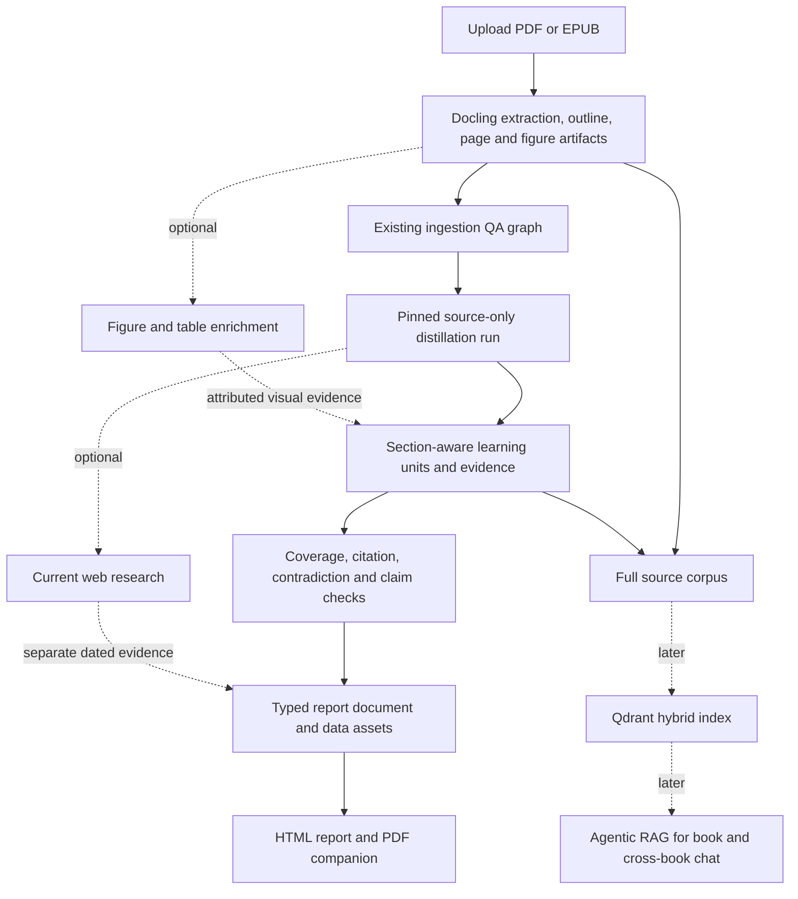

# Book Distiller: Distill feature, learning report, visuals, and later RAG

**Status:** Product and architecture reference. The source-only backend pilot is implemented; status and remaining stages are recorded in §12. Use it with the existing [Book Distiller product decision](BOOK-RESEARCH-FEATURE-SOTA-2026-10-30.md), [ingestion architecture](BD-INGESTION-AGENTIC-AI-ARCHITECTURE-2026-11-03.md), and [ingestion agent SOTA review](BD-INGESTION-AGENTIC-AI-SOTA-2026-11-06.md).  
**Research snapshot:** 2026-11-06. Framework, renderer, and visualization versions must be rechecked when implementation starts.

## 1. Product objective

Book Distiller should help a reader learn a book's important ideas in less time, retain the supporting explanations and caveats, and apply the ideas more effectively. The experience is:

> Upload a book → prepare and verify its extracted source → distill evidence-backed learning material → read a shorter, navigable report → inspect original pages when needed → later ask cited questions across one or more books.

Treat “learn everything from the book without losing learning quality” as the product goal to measure, not as a guarantee made by a summarizer. The report should preserve broad chapter coverage, source traceability, enough explanation to teach the ideas, and practice material. Measure whether readers understand, recall, and apply the content; a lower page count alone is not a success metric.

The report is a first-class product artifact. It can include structured lessons, examples, datasets, charts, equations, diagrams, decision aids, and exercises in addition to prose. Agents should produce these as validated content objects; trusted code should assemble and render them.

## 2. What the repository has today

BD now has two server-side stages: source preparation/ingestion QA and a source-only Learning Guide pilot. The Distill API and report renderer exist, but the web product has not yet integrated that API, and the pilot has not passed human learning-outcome evaluation.

| Area | Current capability and relevant code |
|---|---|
| Upload and extraction | PDF/EPUB dispatch, retries/resume, page-slice extraction, object storage, and optional automatic chaining are in [`dispatch/service.py`](../apps/server/domains/bd/ingestion/runtime/dispatch/service.py). The current page limit is 3,000. |
| Outline | PDF bookmarks and extracted headings produce an outline and page `section_path`; see [`outline/domain.py`](../apps/server/domains/bd/ingestion/outline/domain.py). |
| Structured documents | Docling output, page Markdown, figures, and manifests are persisted. OCR and vision-based image/chart enrichment are configurable but currently off by default in [`extract/config.py`](../apps/server/domains/bd/ingestion/extract/config.py). |
| Ingestion Agentic AI run | Run identity is pinned to an extraction run and its manifest hash in [`ai/service.py`](../apps/server/domains/bd/ingestion/ai/service.py) and [`ai/schemas.py`](../apps/server/domains/bd/ingestion/ai/schemas.py). |
| Ingestion graph | The five sequential stages are `audit_batch → plan_repairs → repair_pages → normalize_metadata → publish` in [`graphs.py`](../apps/server/ai/bd/graphs/ingestion/graphs.py), with typed graph state in [`states.py`](../apps/server/ai/bd/graphs/ingestion/states.py). Agents audit extracted pages and propose bounded repairs; deterministic checks control routing, patch safety, hashes, and publication. |
| Publication | The current publish stage checks page artifacts and text-loss indicators and writes a quality report; see [`publish/service.py`](../apps/server/ai/bd/nodes/ingestion/publish/service.py). This is not a learning-fidelity or educational-outcome evaluation. |
| Distill | A separate run pins the extraction and QA manifests, extracts and verifies learning units, synthesizes chapters/book, and publishes JSON and HTML. See [`distill/service.py`](../apps/server/domains/bd/distill/service.py) and [`distill/router.py`](../apps/server/entrypoints/api/v1/bd/distill/router.py). Structural citation and coverage checks are recorded; a human-reviewed gold set is still needed. |
| Report formats | Static, script-free HTML is stored with the report. Print-ready CSS and an on-demand PDF endpoint use the isolated headless Chromium service when `PLAYWRIGHT_CDP_HEADLESS` is configured. |
| API/UI | The ingestion API and BD UI expose upload, run lifecycle/progress, reading, and page review. The Distill API is registered, but the BD UI does not yet expose it. The current UI API helpers are in [`api.ts`](../apps/web/src/features/bd/api.ts). |
| Retrieval infrastructure | Shared Qdrant, Elasticsearch, and Neo4j clients exist under `apps/server/infra/`. Their presence does not mean BD has an indexed corpus or should use all three. |

The existing source manifests, hashes, chapter paths, figures, immutable storage, progress events, and graph checkpointing should be reused. The current extraction request passed to the graph includes ordered page references, but does not itself carry all outline context; the new distillation run must load and pin the appropriate outline/section data from the extraction artifacts.

**Scale finding:** page work currently runs in batches inside graph nodes. Progress events do not make every individual model result a durable graph checkpoint. For book-length distillation, make each bounded section/chapter unit restartable and idempotent, write completed artifacts outside graph state, and keep graph state to references and compact metadata. LangGraph documents fan-out with `Send` and persistence/task patterns for isolating durable work ([graph API](https://docs.langchain.com/oss/python/langgraph/graph-api), [persistence](https://docs.langchain.com/oss/python/langgraph/persistence)).

## 3. Target architecture

Keep ingestion QA, book distillation, optional current-web research, report rendering, and future question answering as separately versioned stages. A distillation rerun should not require re-uploading or re-extracting the source.

### Distill graph stages

1. **Validate and pin input.** Require a completed extraction and the intended ingestion QA run. Pin book ID, extraction/run IDs, hashes for source and outline manifests, page count, workflow/schema/prompt versions, models, optional web-research date, and output renderer versions.
2. **Build the reading hierarchy.** Use the existing TOC/headings and `section_path`. Repair missing hierarchy only through a bounded, verifiable step. Preserve physical page identity, and represent front matter, appendices, unassigned pages, and image-only pages explicitly.
3. **Create bounded content units.** Split long sections into context-sized units while preserving heading breadcrumbs, page boundaries, tables, and nearby figure references. Do not treat physical pages as the only semantic unit.
4. **Extract learning units in parallel.** Use fixed, typed work roles for claims, concepts, definitions, procedures, evidence, examples, caveats, and actions. Use bounded LangGraph fan-out over known units; DeepAgents can provide specialist context/tooling where useful. Avoid one dynamically spawned agent per page.
5. **Verify local coverage and evidence.** Check source locators deterministically; ask a verifier whether the cited span supports the claim; preserve unresolved findings as uncertain/review-required. Record what was omitted or could not be read rather than silently filling gaps.
6. **Synthesize across sections.** Assemble chapter guides from learning units, then identify supported cross-chapter connections, dependencies, repeated ideas, and contradictions. Avoid “summary of summaries” as the only evidence path: synthesis must retain links to the underlying source units.
7. **Add optional figure and web evidence.** Figure descriptions, formulas, and chart tables can be enriched using a vision model after source-only extraction quality is measured. Web research is a separate branch with source URL, source type, publication/access date, and evidence; it must not silently alter what the book says.
8. **Build, check, and publish the report.** Compose a `StudyGuideDocument`, run schema/citation/coverage/asset checks, render outputs, then publish a versioned report manifest last. Keep incomplete runs separate from the active report.

LangGraph should own the predictable workflow and durable checkpoints. Agents should make bounded judgments inside stages. Deterministic code should own routing where rules are known, schemas, citation resolution, data transformations, safe file handling, and publication invariants. DeepAgents' skills/subagents can support specialized tasks; they do not replace graph-level state, retries, and run identity. See [DeepAgents overview](https://docs.langchain.com/oss/python/deepagents/overview) and [subagents](https://docs.langchain.com/oss/python/deepagents/subagents).

## 4. Canonical artifact model

Persist a typed, versioned intermediate representation instead of making generated Markdown, LaTeX, Python, or HTML the source of truth. Pydantic schemas fit external/agent boundaries; graph state should contain compact `TypedDict` state and references, following existing server conventions.

### `DistillRunManifest`

Pin at least:

- `book_id`, extraction run ID, ingestion QA run ID, expected page count, outline key/hash, source manifest key/hash;
- run ID, status, timestamps, progress and errors;
- workflow and schema versions, prompts/skills, model/provider settings, relevant decoding limits;
- optional web research mode, access time, and evidence bundle version;
- report document, chapter artifact, dataset, figure, and rendered output keys with checksums;
- evaluation results and review status.

This makes reruns comparable and prevents a report from accidentally mixing pages from different extraction candidates.

### `SourceRef` and `LearningUnit`

Every substantive book-derived item should be traceable to one or more stable source references. A source reference should carry a source class (`book`, `web`, `agent_inference`), book/run identity, page number, section path, stable chunk/span ID, source hash, and a resolvable storage locator. Keep short supporting spans where appropriate; the page remains the canonical inspection destination.

A learning unit should include:

- stable unit ID and kind (`principle`, `definition`, `method`, `example`, `fact`, `caveat`, `action`, etc.);
- concise claim plus enough explanation to teach it;
- author/book claim versus system inference attribution;
- evidence references, confidence/uncertainty, and validation/review status;
- relations to concepts, prerequisites, and other learning units.

### `StudyGuideDocument` and visual assets

The document contains ordered sections and typed blocks such as `Lesson`, `Definition`, `Procedure`, `WorkedExample`, `DecisionTable`, `Equation`, `Chart`, `Diagram`, `Timeline`, `Glossary`, `Exercise`, `Caveat`, and `Citation`. A block holds content and references; it does not contain arbitrary renderer code.

Store chart data separately from chart appearance. A `Dataset` should describe columns, types, units, observations, row/cell provenance where feasible, transformations, assumptions, and confidence. A `ChartSpec` references that dataset and declares a chart type, encodings, labels, caption, accessible description, and source references. A `DiagramSpec` should have typed nodes and typed, evidence-linked edges; label relations accurately (for example, distinguish “causes” from “is associated with”). An `EquationBlock` should include LaTeX expression, symbol definitions, units, assumptions, worked example/derivation when warranted, and evidence.

## 5. Recommended reader-facing report

Use progressive depth so a reader can orient quickly without losing access to the book's substance:

1. **Book and report scope:** book metadata, edition/source, report depth, processing run, extraction limitations, and how to inspect citations.
2. **Quick orientation:** central thesis, key takeaways, and a learning map.
3. **Chapter-by-chapter guide:** the question/problem, core ideas, reasoning, examples, caveats, and actions for each chapter.
4. **Whole-book synthesis:** frameworks, dependencies, tensions, recurring concepts, and what conclusions depend on earlier chapters.
5. **Decision and practice aids:** comparison tables, procedures, decision trees, and application playbooks with assumptions and constraints.
6. **Reference section:** glossary, equations, structured data/figures, recall questions, and source index.
7. **Optional current context:** separately marked external research with dated primary sources and explicit links back to the book topics.

Every fact or recommendation attributed to the book should link to book evidence. Mark an inference as an inference. Mark web context as external and dated. Preserve disagreement between the book and external evidence rather than blending the sources into a single unattributed narrative.

### Visual selection rules

| Structure | Use it for | Required evidence/data |
|---|---|---|
| Comparison/decision table | Comparing methods, choices, criteria, benefits, risks | Source reference per meaningful row or cell; explicit criteria and units |
| Bar/line/scatter/distribution chart | Numeric quantities, time trends, comparisons, relationships | Validated values, units, transformations, assumptions, source references, accessible summary and data table |
| Flowchart/decision tree | A process, ordered method, or conditional choice described in the book | Evidence for steps, conditions, and outcomes; preserve uncertainty and exceptions |
| Concept map/graph | Concepts and their relationships across sections or books | Typed relation (`defines`, `requires`, `supports`, etc.) with evidence per important edge |
| Timeline | Events or dated developments where order is meaningful | Dates/events, source locators, uncertainty for approximate dates |
| Equation | Mathematical relationship or model | LaTeX, symbol/unit definitions, assumptions, cited derivation or source |
| Worked example | Applying an idea or formula to a concrete case | Inputs, steps, result, assumptions, and distinction between book example and generated example |

Use a chart only when there is a dataset or a clearly identified conceptual structure. Do not invent numeric values to make a visual. Charts and diagrams need a useful text alternative; provide their data in a table when practical, consistent with [W3C WCAG guidance](https://www.w3.org/WAI/WCAG22/Understanding/non-text-content.html).

## 6. Report formats and rendering tools

**Default:** interactive HTML report in BD, plus a print-ready PDF download. HTML supports linked page citations, interactive charts, navigation, search, and expandable depth. PDF is valuable for offline reading and printing, but interactive charts become static images.

Generate both outputs from the same validated report model. Quarto is a practical rendering option for a long-form publication: it supports multiple output formats, Mermaid/Graphviz, and PDF through Typst or LaTeX. Prefer Typst for the initial PDF path when its typography/features meet the report requirements; use LaTeX for a specific math, publisher, or typesetting requirement. Keep LaTeX as the equation notation even if the overall document uses another renderer. Do not allow the agent to write arbitrary raw TeX/HTML into the document model.

| Tool/format | Version snapshot as of 2026-11-06 | Recommendation and trade-off |
|---|---|---|
| Quarto | 1.11.9 latest stable, 2026-10-30; 1.12.0 is marked prerelease, 2026-11-02 | Good candidate for long-form HTML/PDF generation with a shared source. Pin the stable release and use a controlled render worker. [Releases](https://github.com/quarto-dev/quarto-cli/releases), [Typst PDF](https://quarto.org/docs/output-formats/typst.html). |
| Plotly.py | 7.1.0, 2026-09-15 | Pragmatic Python chart path for interactive HTML and static export. Static image rendering requires Kaleido and Chrome, which must be present in the renderer image. [Releases](https://github.com/plotly/plotly.py/releases), [figure data](https://plotly.com/python/figure-structure/), [static export](https://plotly.com/python/static-image-export/). |
| Vega-Lite | 6.5.0, 2026-10-08 | Declarative JSON grammar for common charts; narrower and easier to constrain than arbitrary plotting code. Consider if strict chart-spec validation and portability matter more than Plotly's Python convenience. [Docs](https://vega.github.io/vega-lite/docs/), [releases](https://github.com/vega/vega-lite/releases). |
| Mermaid | 12.2.0, 2026-10-13 | Compact text syntax for flowcharts and other supported diagram types. Keep strict security settings and validate/render generated diagrams before publication. [Releases](https://github.com/mermaid-js/mermaid/releases), [security levels](https://mermaid.js.org/config/schema-docs/config-properties-securitylevel.html). |

The exact version set is a research snapshot, not a lockfile recommendation. Check compatibility and support dates before implementation; pin Quarto, Mermaid, Plotly/Kaleido/Chrome, and any PDF fonts/renderers in the build image.

## 7. Generated code and sandbox boundary

Schema-first generation should handle the common case: agents return a dataset, chart specification, equation, or diagram structure; trusted renderers build the asset. Permit generated Python only when it adds measured value, such as a calculation that cannot be expressed by an existing transformation or a specialized plot.

Treat generated code and all book/web content as untrusted. A code-render job should be ephemeral, isolated from application credentials and host files, non-root, default-deny for network egress, limited to preinstalled packages, and bounded by CPU, memory, process, file-size, and wall-clock limits. Provide source assets read-only and a separate output location. Do not let code install arbitrary packages, access the database/object store directly, or call external tools. Validate output paths, MIME types, size, dimensions, and active content before storing or serving artifacts; sanitize SVG/HTML and reject unexpected files. Official sandbox guidance also warns against relaxing egress, mounting secret-bearing paths, or passing credentials to untrusted code ([Cloud Run code-execution security boundaries](https://docs.cloud.google.com/run/docs/code-execution)).

The report renderer should consume typed blocks and validated assets, not execute scripts or code embedded in the uploaded book. Mermaid should remain at its documented strict security setting for user-visible generated diagrams.

## 8. Later Agentic RAG architecture

Do not build chat by indexing only the compressed report. Keep the original extracted pages as the complete source and index them alongside the validated learning units, section/chapter context, and report blocks. This lets chat answer details intentionally omitted from the short guide.

Start with Qdrant for BD because shared Qdrant infrastructure already exists. Use a rebuildable hybrid index combining lexical/BM25 and dense semantic retrieval, with metadata for book, extraction run, page, section, source type, and chunk level. Use a parent-child hierarchy: retrieve precise page/section passages, then open their parent section or chapter for context. Add an agent loop with bounded tools such as `search_book`, `read_source`, `read_section`, and `find_related_concepts`; verify that answer citations resolve to retrieved material before returning an answer.

Offer explicit modes: one book, selected books/corpus, and optionally current web context. Keep web citations distinct from book citations. Add reranking or graph traversal only when retrieval evaluations show a specific failure they solve.

| Store | Repository/current snapshot | Decision |
|---|---|---|
| Qdrant | Existing infra; lock resolves client 1.16.1. Official client/server 1.20.0 released 2026-10-22; v1.20 adds BM25 scoring on full-text payload indexes. | Recommended first retrieval index. Confirm client/server compatibility and evaluate the existing sparse-vector route before adopting new BM25 functionality. [Client](https://pypi.org/project/qdrant-client/), [server releases](https://github.com/qdrant/qdrant/releases), [hybrid queries](https://qdrant.tech/documentation/hybrid-queries/). |
| Elasticsearch | Project allows `<9`, lock resolves 8.19.3; official Elastic release is 9.5.6 (2026-11-02). Existing `infra/elasticsearch/schemas.py` marks two indexes deprecated. | Do not add as a second BD index by default. Reconsider if the team chooses to upgrade and operate Elastic for a concrete search requirement. [Downloads/releases](https://www.elastic.co/downloads/elasticsearch), [local schemas](../apps/server/infra/elasticsearch/schemas.py). |
| Neo4j | Existing driver lock 5.28.4 and project cap `<6`; latest official Python driver 6.4.1 (2026-10-15). | Defer until measured multi-hop/cross-book concept questions benefit from graph traversals. A knowledge graph adds extraction, consistency, and maintenance work; it does not automatically improve retrieval. [Driver releases](https://github.com/neo4j/neo4j-python-driver/releases). |

The repository lock also resolves LangGraph 1.2.16 and DeepAgents 0.6.8, while current official releases are LangGraph 1.2.20 and DeepAgents 0.7.34 (both 2026-11-05). Upgrade independently of the initial distillation implementation, pin versions, and regression-check the existing agent factories—especially code that depends on private framework attributes. [LangGraph releases](https://github.com/langchain-ai/langgraph/releases), [DeepAgents changelog](https://github.com/langchain-ai/deepagents/blob/main/libs/deepagents/CHANGELOG.md).

## 9. Evaluation and promotion gates

Create a human-reviewed gold set before optimizing agents. Use several representative books, varied in structure and content, and prepare chapter-level facts, citations, and questions. A single book or a single whole-book summary score is not adequate.

Measure at least:

1. **Coverage and omission:** important lessons represented across chapters, including middle and late sections; explicit accounting for unprocessed or unreadable source material.
2. **Evidence quality:** source locator resolves; cited span supports the claim; unsupported or over-generalized claims; attribution errors between book claims, web facts, and model inference.
3. **Synthesis quality:** correct cross-chapter relationships, preserved disagreement, no false causal edges, and useful caveats.
4. **Visual correctness:** chart values reproduce from the stored dataset/transformation; equation assumptions and calculations check; diagram edges map to evidence; PDF/HTML assets render consistently.
5. **Learning utility:** comprehension, immediate and delayed recall, transfer/application questions, reading time, reader confidence, and ability to find supporting passages.
6. **Operations:** token/model cost, latency, retry/resume correctness, duplicate work, artifact integrity, and failure/review rates.

Use deterministic tests for invariants and citation resolution, plus human review and calibrated model graders for semantic support. Do not use an LLM judge as the sole quality gate. Long-form summarization research reports positional/coverage issues and limitations in automatic faithfulness evaluation; evaluation should deliberately include evidence from across the whole book ([NAACL 2025 long-form faithfulness study](https://aclanthology.org/2025.naacl-long.442/), [ICLR 2024 book-length summary evaluation](https://openreview.net/pdf?id=7Ttk3RzDeu), [EMNLP 2025 evidence-span study](https://aclanthology.org/2025.emnlp-main.95/)).

Promote a report only when its source manifest is complete, required citations resolve, no critical coverage or grounding failures remain, and the output renderer has successfully produced the required formats. Preserve lower-confidence claims and review flags in the artifact rather than silently dropping them.

## 10. Recommended implementation sequence

1. **Define the report contract and evaluation set.** Decide report depths, block types, citation identity, attribution labels, and measurable learning outcomes. Build a small gold set with human-checked chapter coverage and questions.
2. **Add a separate Distill run and schemas.** Introduce the manifest, `SourceRef`, `LearningUnit`, `Dataset`, `VisualSpec`, and `StudyGuideDocument`. Pin it to existing extraction and ingestion-QA runs.
3. **Build a source-only pilot graph.** Outline → bounded section units → parallel learning extraction → evidence/coverage checks → chapter and book synthesis → report model. Persist each unit/chapter as an immutable artifact and make retries idempotent.
4. **Render the first report.** Start with cited prose, tables, glossary, and exercises. Deliver interactive HTML and a printable PDF from the same validated document. Evaluate on 2–3 varied pilot books and revise the schema/report depth based on evidence.
5. **Add visual enrichment.** Introduce validated datasets/charts, sourced diagrams, equations, and selected VLM analysis of figures. Add render and accessibility checks.
6. **Add optional current research.** Give a dedicated, bounded web-research step a clear source policy. Display its dated evidence separately from the book-derived guide.
7. **Index and add RAG chat.** Build Qdrant hybrid retrieval over original source units plus derived records; evaluate citations and cross-book synthesis before introducing Neo4j or more infrastructure.

This sequence prioritizes a demonstrably useful book-learning report before optional web augmentation and cross-book chat. It keeps the later RAG system grounded in the same source references and learning records.

## 11. Research references

- LangGraph [graph API](https://docs.langchain.com/oss/python/langgraph/graph-api) and [persistence](https://docs.langchain.com/oss/python/langgraph/persistence).
- DeepAgents [overview](https://docs.langchain.com/oss/python/deepagents/overview) and [subagents](https://docs.langchain.com/oss/python/deepagents/subagents).
- Docling [vision model enrichment](https://docling-project.github.io/docling/usage/vision_models/).
- Quarto [multi-format documents](https://quarto.org/docs/output-formats/html-multi-format.html), [diagrams](https://quarto.org/docs/authoring/diagrams.html), [PDF engines](https://quarto.org/docs/output-formats/pdf-engine), and [release history](https://github.com/quarto-dev/quarto-cli/releases).
- Plotly [figure JSON structure](https://plotly.com/python/figure-structure/) and [static export](https://plotly.com/python/static-image-export/); Vega-Lite [JSON grammar](https://vega.github.io/vega-lite/docs/); Mermaid [security levels](https://mermaid.js.org/config/schema-docs/config-properties-securitylevel.html).
- W3C [WCAG non-text content guidance](https://www.w3.org/WAI/WCAG22/Understanding/non-text-content.html).
- Google Cloud [sandbox execution boundaries](https://docs.cloud.google.com/run/docs/code-execution) as one official reference for isolating untrusted code; this is not a platform selection for Nexus.
- Long-form summarization studies: [NAACL 2025](https://aclanthology.org/2025.naacl-long.442/), [ICLR 2024](https://openreview.net/pdf?id=7Ttk3RzDeu), [EMNLP 2025](https://aclanthology.org/2025.emnlp-main.95/).

## 12. Implementation status — 2026-11-07

The product name remains **Book Distiller**. Its BD feature is **Distill**, and its reader-facing artifact is a **Learning Guide**.

The server now has a source-only distillation pilot. It requires completed extraction and ingestion QA, pins each run to both immutable manifests, splits normalized source pages into bounded chunks, extracts typed learning units, checks page quotations and an independent evidence verdict, synthesizes section guides and a hierarchical whole-book guide, and stores JSON plus static HTML. Runs have queued/running/done/failed/cancelled lifecycle, progress events, cooperative cancellation, retryable persisted artifacts, and a LangGraph checkpointer. The report includes page citations, explicit book-claim versus agent-inference labels, review flags, uncovered-page accounting, a glossary, recall questions, sourced diagrams and equations, and schema-validated datasets with static SVG charts/diagrams and accessible data/evidence tables. Reports remain marked for human review because a representative human-reviewed evaluation set has not yet been established.

Core implementation entry points are the [Distill run contract](../apps/server/domains/bd/distill/schemas.py), [run lifecycle](../apps/server/domains/bd/distill/service.py), [Distill graph](../apps/server/ai/bd/graphs/distill/graphs.py), [report publisher](../apps/server/ai/bd/nodes/distill/publish_report/service.py), and [HTTP router](../apps/server/entrypoints/api/v1/bd/distill/router.py).

This is the first backend phase, not the complete product rollout. The following planned stages remain:

1. Add the Distill API to the BD web client and build the run lifecycle, progress, report, PDF download, and source-review experience. The exact allowed web paths must be included in the implementation brief under `apps/web/AGENTS.md`.
2. Provide representative human-reviewed books and run the evaluation harness in [`test_bd_distill_quality.py`](../scripts/server/test_bd_distill_quality.py) and [`evaluate_bd_learning_guide.py`](../scripts/server/evaluate_bd_learning_guide.py). Deterministic structural checks and a per-book small-beta gate are implemented; actual human outcomes, costs, and real-book coverage still need measured results.
3. Exercise the on-demand PDF renderer against the headless Chromium endpoint already declared in [`values.yaml`](../k8s/helm/values.yaml), then validate long reports, page breaks, source links, accessibility, and download behavior.
4. Add optional dated web research through bounded tools. Keep external facts and citations distinct from book-derived material and retain full source evidence for every addition.
5. Add later cross-book Agentic RAG over original extracted pages and derived learning records. Start with the existing Qdrant infrastructure and add other stores only after retrieval evaluations justify them.

The present graph deliberately does not execute agent-generated code, run live web research, or index a corpus. Charts and diagrams use constrained schemas and trusted static renderers. Keep code execution deferred until a concrete report use case and an isolated runtime are available.
