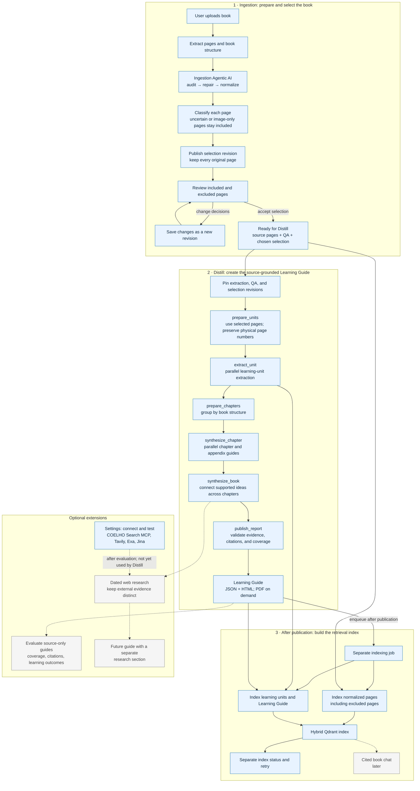

# BD Distill Agentic AI flowchart

Solid paths show implemented structure. Dashed paths show later work that is not wired into Distill yet. Distill execution is available by default.

## Key boundary

Distill creates the Learning Guide from the pinned selection. RAG indexing runs afterward over the complete normalized Ingestion book, including pages excluded from the guide. The index prepares for later retrieval and chat; it does not currently help write the guide.

Search connections can be configured and tested in Settings, but Distill does not call them yet. Add web research after evaluating the source-only guide, and keep external findings separate from what the book says.
