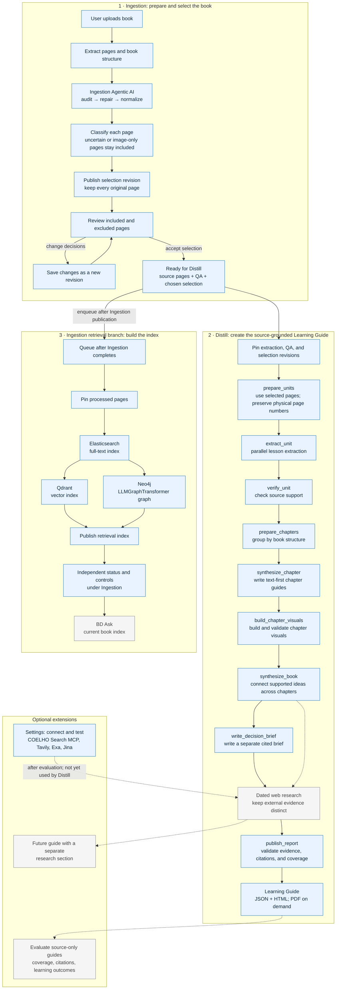

# BD Distill and Ingestion Retrieval flowchart

Solid paths show implemented structure. Dashed paths show later work that is not wired into Distill yet. Distill execution is available by default.

## Key boundary

Distill creates the Learning Guide from the pinned selection. Agentic RAG runs as an independent branch after Ingestion publishes processed pages; it indexes those pages in Elasticsearch, Qdrant, and Neo4j. The retrieval process is displayed under Ingestion and does not delay Distill report publication.

Search connections can be configured and tested in Settings, but Distill does not call them yet. Add web research after evaluating the source-only guide, and keep external findings separate from what the book says.
