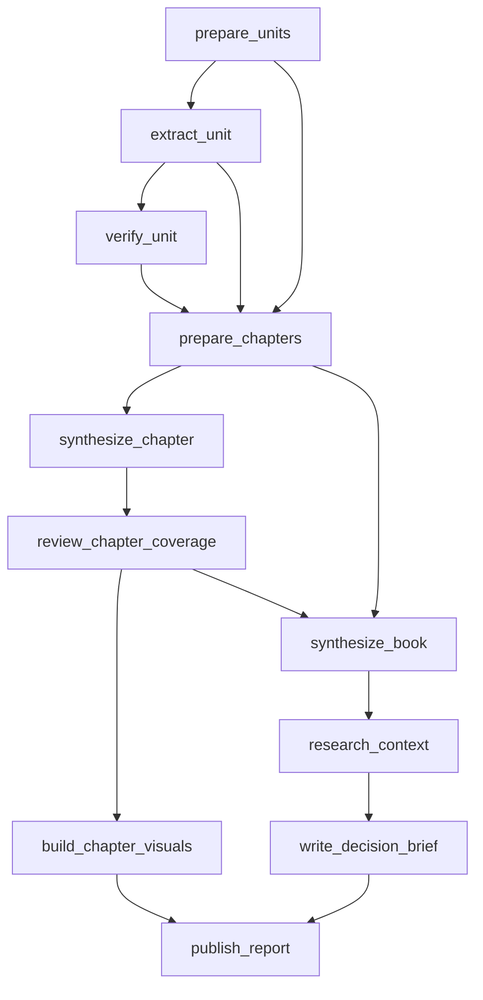

# BD Distill Agentic AI — code audit and target architecture (2026-11-22)

**Status:** COELHONexus has chapter objectives and practice, bounded chapter coverage review/repair, verified full-source research, research-informed decision citations, and selected source figures. The generated-illustration path has been removed from Distill and COELHO LLM Rotator because it did not justify the added workflow complexity; image generation should be evaluated as an ArtCraft capability instead. ArtCraft is not present in this workspace. A public BD MCP surface and human learning-outcome evaluation remain pending. The existing architecture in [BD-BOOK-DISTILLATION-AND-REPORT-ARCHITECTURE-2026-11-06.md](BD-BOOK-DISTILLATION-AND-REPORT-ARCHITECTURE-2026-11-06.md) remains the product reference; this is a delta audit based on the current code and the FastMCP studies.

## Recommendation

Keep the present LangGraph workflow and source-grounded report model. Improve it as a measured teaching product with carefully separated current research, selected book figures, and deterministic, typed evidence visuals. Keep text-to-image generation outside Distill; if it earns its place as a product feature, implement it under ArtCraft and integrate by a narrow asset contract.

Treat “same learning in less time” as a result to demonstrate with readers, not a promise made by the model. Keep three kinds of content visibly separate throughout the report:

1. **Book lesson:** what the supplied edition says, linked to verified units and page evidence.
2. **Current context:** what recent external sources support, challenge, or update, with publication and access dates.
3. **Decision synthesis:** options and actions based on the reader’s decision question, with book and external support separately cited.

## What exists in the repository

The current Distill graph is already a fixed, resumable workflow with bounded chapter and unit fan-out. It extracts and verifies lesson candidates, synthesizes chapters and the book, builds evidence-linked diagrams/charts/equations/timelines/maps, optionally gathers Search MCP context, writes a decision brief, reviews the report, and publishes JSON/HTML/PDF artifacts. See [the root graph](../apps/server/ai/bd/graphs/distill/book_distillation/main/graphs.py), [run state and dependencies](../apps/server/ai/bd/graphs/distill/book_distillation/states.py), [report schemas](../apps/server/domains/bd/distill/schemas.py), [publication service](../apps/server/domains/bd/distill/publish_report/service.py), and [HTML/SVG renderer](../apps/server/domains/bd/distill/rendering/domain.py).

| Existing capability | Code-grounded finding | Remaining product gap |
|---|---|---|
| Run and graph lifecycle | Input manifests are pinned; graph state is compact; stage artifacts are stored separately; nodes have bounded retries, progress, cancellation, resume, and replay. | Every new graph stage must join the replay graph, usage counters, progress contract, and artifact invalidation rules. |
| Book fidelity | Extractor and verifier preserve exact page quotes, stable learning-unit IDs, attribution, confidence, and review flags. Publication re-resolves references and checks evidence quotes against pinned text. | A supported quote does not prove that all important lessons from a chapter were captured. Current page coverage is not a semantic chapter-completeness score. |
| Report model | Chapters carry optional typed learning objectives, answer/feedback practice items, and selected source-figure references. HTML and PDF retain text alternatives and expandable answers. | Objective completeness and learning parity still need human outcome evaluation. |
| Visuals | Typed evidence visuals remain code-rendered. The visual builder can select up to three existing figures per chapter; publication checks the pinned manifest, page, hash, and exact caption before embedding them. | Visual usefulness still needs human evaluation. |
| External research | Search MCP remains optional and bounded. A run-scoped `read_search_source` reads only returned source IDs, hashes bounded full text, and findings must quote exact passages. | Full-source reading is available only when the selected Search MCP provider exposes a compatible URL-read tool. Sources without verified passages can appear as references but cannot support findings or recommendations. |
| Decision brief | The graph now runs `research_context` before `write_decision_brief`; verified external findings can be cited separately from book evidence. | Current recommendations still need reader-specific goals and human evaluation before the guide can claim to produce the best possible decision. |
| Quality review | Each chapter now gets a read-only coverage/evidence review and at most one targeted repair; final structural validation remains authoritative. | Automated review does not prove lesson completeness. The `HumanLearningReview` model and aggregation logic exist, but there is no human-review collection path or completed learning-outcome gold set. |

The report’s structural gate checks page accounting, source identity/hashes, quote support, and research-source integrity. It does not establish semantic lesson completeness or reader learning parity. The current docs also explicitly describe human learning-outcome evaluation as future work. Keep that limitation visible in the user experience.

## Target workflow

Retain the current specialist agents and graph coordinator. Add only the capabilities that close measured report gaps; do not replace the predictable graph with a free-running agent swarm.

Current LangGraph node IDs only. Coverage repair runs inside `review_chapter_coverage`; source-figure selection runs inside `build_chapter_visuals`.

Implementation details:

- Continue to use **LangGraph** for stage order, `Send` fan-out, durable checkpoints, retries, replay, and routing. Keep long source/report payloads in object storage and put only references and compact metadata in graph state. This matches the current graph and LangGraph persistence model. [LangGraph persistence](https://docs.langchain.com/oss/python/langgraph/persistence)
- Treat each chapter as a teachable unit, not just a short summary: chapter question, measurable learning objectives, the core explanation, reasoning/method, a worked example or counterexample where supported, assumptions/caveats, and a decision/application prompt.
- Add practice items with a question, answer, explanation, target learning-unit IDs, difficulty, and corrective feedback. Put the answer behind an explicit reveal in HTML and in a separated answer section in PDF. A question without feedback is a weaker learning check.
- Add an explicit map from each chapter objective to verified learning-unit IDs and a status (`covered`, `partial`, `not_in_source`, `review_required`). Require a clear omission note for important uncovered material. Keep any LLM completeness judge read-only; only request a targeted repair for flagged chapters.
- Keep evidence-bearing diagrams, charts, maps, timelines, and equations in validated typed structures and render them through trusted code. Include original book figures only when their source and page are traceable.
- Make current research and the decision brief sequential. `research_context` should return a completed, unavailable, or disabled artifact; then `write_decision_brief` can use that context when present and remain source-only otherwise. The final model must say which recommendation is the author’s, which is the system’s synthesis, and which external sources materially affect it.

## Reader-facing report structure

The report should support a quick orientation and a deeper lesson without compressing away the reasoning that makes a chapter useful.

### Whole-book front matter

- Edition/source identity, report scope, extraction limits, selected/excluded pages, and a plain explanation of citation markers.
- A one-screen learning map: central thesis, prerequisite relationships, major chapter questions, and a page-coverage map.
- A scope note that distinguishes the author’s claims, model inference, and current external context.

### Repeated chapter template

1. **Chapter question and outcomes:** what the reader should be able to explain, recall, distinguish, or do after the chapter.
2. **Recall before reading:** one or two diagnostic questions, with answers hidden until requested.
3. **Teaching section:** the core ideas in the chapter’s order, with enough explanation to preserve argument, process, examples, qualifications, counterexamples, and unresolved questions.
4. **Worked example or application:** sourced if present in the book; otherwise labeled as a generated application example with its assumptions.
5. **Visuals:** the original figure when it is instructionally useful; an evidence-linked flowchart/concept map/chart when the source supports one.
6. **Practice with feedback:** recall and transfer questions, answers, reasoning, and common-error feedback. Answers should cite the relevant chapter units.
7. **Decision/action aid:** steps, criteria, risks, and success measures where the chapter supports practical action.
8. **Source trail and gaps:** clickable physical-page citations, relevant original-page previews, and any omissions or unreadable material.

### Whole-book closing sections

- Cross-chapter connections and prerequisites, supported by source IDs.
- Glossary, formulas, data tables, and a study/review plan.
- A dated **Current context** appendix with external sources and their relationship to specific book topics.
- A **Decision Brief** that includes the question, recommendation, alternatives, trade-offs, risks, assumptions, actions, and what new evidence would change the recommendation.

Use meaningful segmentation and progressive disclosure: let readers work through one concept at a time, but do not split a coherent argument into tiny fragments. A 2019 meta-analysis of 56 investigations found a small-to-medium benefit from segmenting multimedia instruction for retention/transfer and lower cognitive load, while also finding increased learning time. Treat it as support for coherent, learner-paced sections, not as a promise that more segmentation is always faster. [Segmenting-effect meta-analysis](https://doi.org/10.1007/S10648-018-9456-4)

Use retrieval practice with corrective feedback and transfer/application tasks, not rereading alone. A 2025 meta-analysis of 44 studies and 142 comparisons found only a small overall advantage for retrieval practice over elaborative learning conditions (`g = 0.14`), and the advantage was conditional on feedback (`g = 0.50`). That favors “question → attempt → answer → explanation” over a bare quiz list. [Retrieval-practice meta-analysis](https://doi.org/10.1007/s10648-025-10076-6)

Visuals should reduce the work of understanding the prose. Keep decorative imagery sparse; use evidence-backed diagrams for relationships and typed charts for real numeric data. Images do not make the report more accurate by themselves.

## Report contracts to add

Keep Pydantic schemas at external/model boundaries and use internal dataclasses/value objects in the domain. Extend schemas additively and version them; do not store base64 image data in report JSON.

| Proposed contract | Fields and purpose |
|---|---|
| `LearningObjective` | Stable ID, outcome statement, related learning-unit IDs, importance, chapter/subsection path, coverage status. This gives the reviewer and evaluator a semantic coverage target. |
| `PracticeItem` | Question, answer, rationale/feedback, question type (`recall`, `explain`, `compare`, `apply`), difficulty, target objectives/unit IDs, source references. |
| `ExternalEvidenceRef` | Stable source ID, canonical URL/DOI, title, author/publisher, source class, publication date, retrieval/access date, retrieved-content hash, exact excerpt/locator, confidence and relation to the book (`supports`, `updates`, `challenges`, `contextualizes`). |
| `VisualAssetRef` | Asset ID/key/hash, MIME type, dimensions, caption and alt text, asset kind (`book_figure` or a future ArtCraft asset), source figure/page and extraction hash when applicable, and related lesson IDs. |
| `DecisionEvidenceRef` | A discriminated reference to book evidence or external evidence. Keep current external evidence out of the existing `SourceRef` until provenance and rendering are explicit. |

For existing book figures, select by original figure name and physical page, retain the extracted bytes and extraction hash, provide an accurate caption/alt text, and link back to the source page. If ArtCraft later provides generated learning visuals, Distill should receive only a validated asset reference with provenance and useful alternative text; the generator and provider credentials should stay outside the Distill graph.

## ArtCraft boundary for future image work

COELHO LLM Rotator is the free-model LLM routing service. Distill should not own a text-to-image provider catalog, model fallback policy, image endpoint, or generated-asset lifecycle. ArtCraft is the proposed home for image creation, but it is not present in this workspace, so its API and integration contract still need to be designed before Distill consumes generated assets. Keep Distill visuals source-grounded and code-rendered until a concrete ArtCraft use case demonstrates learning value.

## External research and decision support

The current Search MCP integration is a good bounded adapter, but source snippets alone are not a sufficient basis for a recommendation that should guide a real decision.

- Keep the user-selected COELHO Search MCP connection and the current strict query/source caps. Add a bounded `fetch_source`/`read_source` operation when the provider supports it, or a server-side allowlisted fetch adapter. Store the resolved URL, redirect chain, title, author/publisher, publication date, access time, retrieved-text hash, and exact supporting passage/locator.
- Prefer primary materials: original research, official standards/documentation, government or institutional data, and source-author material. Use reviews to frame broader evidence, and label their nature. Make the research plan answer a defined question; do not search every book claim.
- Treat all fetched text as untrusted data. Prevent SSRF (HTTPS, hostname/IP checks, blocked private/link-local destinations, redirect checks, byte/time limits, MIME allowlist) and never let retrieved instructions invoke tools.
- Add a provenance relation for each finding to the book idea it updates, supports, challenges, or contextualizes. Keep external claims in their own appendix and source references.
- Run `write_decision_brief` after the optional research artifact exists. If research is disabled or unavailable, produce the present source-only brief. If research is complete, make the recommendation conditional on that dated evidence and provide the external references explicitly.
- Preserve whether a current source conflicts with the book; do not rewrite the author’s lesson to match current findings.

## MCP tools, prompts, resources, and middleware

Use MCP as a stable interoperability boundary for clients and external systems, not as the internal API between every graph node. Inside Distill, call existing domain services directly; MCP round trips would add latency and obscure typed ownership. The project already mounts FastMCP inside the FastAPI application at `/mcp` and has a Search MCP client adapter.

The MCP protocol distinguishes **model-controlled tools**, **application-controlled resources**, and **user-controlled prompts**. MCP also recommends a user ability to deny tool calls. Design the surface accordingly. [Tools](https://modelcontextprotocol.io/specification/2026-07-28/server/tools), [resources](https://modelcontextprotocol.io/specification/2026-07-28/server/resources), [prompts](https://modelcontextprotocol.io/specification/2026-07-28/server/prompts), [authorization](https://modelcontextprotocol.io/specification/2026-07-28/basic/authorization).

| MCP component | BD Distill use | Guardrails |
|---|---|---|
| Tools | `search_book`, `read_source_page`, `read_source_figure`, `get_distill_run`, and a user-approved `start_distill`/`cancel_distill` surface. `fetch_source` is limited to the bounded research agent. | Strict schemas, small results, source/user ownership checks, idempotency, explicit tool descriptions, and activity visibility. Keep destructive `wipe`/`replay` out of a general agent toolset or require explicit approval and scope. |
| Resources | Read-only URI templates for an authorized book outline/page, selected source figure, pinned report, chapter, and report asset. Use version/hash in immutable report resources. | Do not list thousands of pages eagerly; resolve authorized resource URIs on read. Never expose raw MinIO keys or arbitrary file paths. Resource visibility is not authorization. |
| Prompts | User-invoked templates such as `distill_book`, `study_chapter`, `compare_chapters`, `refresh_current_context`, and `build_decision_brief`, with IDs and scope as arguments. | Keep prompt templates versioned; do not put secrets or entire books in prompt arguments; pass resource links where supported. Keep internal specialist system prompts separate from user-selectable MCP prompts. |
| Provider composition | A small local provider for BD report/source capabilities and the selected remote Search MCP provider. Namespace the providers by capability. | Do not expose an unrestricted filesystem provider or proxy every connected server to every agent. Add tools only to the roles that need them. |
| Middleware | Authentication/tenant resolution, request and run correlation, redacted audit, request-size limits, rate/quota controls, safe error mapping, and caching for immutable read-only resources only. | Filters and tags control discovery; they do not replace checks in the operation/domain. Avoid logging source text, prompts, secrets, or image bytes. |
| Background tasks | Optional task status/progress for external MCP clients that support the extension; map task IDs to the existing Celery/LangGraph run ID. | Do not create a second Distill durable-work engine. Keep Celery + LangGraph as the source of run status; FastMCP task support can be a transport adapter only. |

Do not make core Distill depend on MCP elicitation or server-side sampling. The user interface already has the book and run context, while FastMCP study 009 demonstrates client capability and protocol-mode differences. Use the existing API/SSE run lifecycle for interactive control.

## Skills, agent tools, and prompt design

The current Distill skill set already has a strong least-capability shape: extraction and verification are source-only; visual construction is schema-bound; the reviewer is read-only; and the decision writer cannot add outside facts. Keep the existing specialist roles and tool allowlists. Give each new ability a separate skill and agent only when it has a distinct contract and evaluation target.

| Skill/role | Recommended contract |
|---|---|
| Existing learning extractor + evidence verifier | Keep source-only and preserve author qualifications. Strengthen the extracted output with objective candidates and a trace from each candidate to one or more verified learning-unit IDs. The verifier should judge the whole claim, not keyword overlap. |
| Chapter teaching synthesizer | Extend the current chapter synthesizer to produce the objective map, explanation sequence, supported examples/caveats, and practice targets. It may cite only the verified units supplied to it. |
| Chapter completeness reviewer | Add a read-only evaluator that compares the chapter outline and human-reviewed objective set with the synthesized guide. It returns omissions and exact source locations; a separate bounded repair call may address only those findings. Do not let it silently change the verified evidence set. |
| Practice-with-feedback builder | Create recall, explanation, comparison, and application items only from covered objectives. Require an answer, reasoning, corrective feedback, and evidence IDs for each item. Mark any novel scenario as an illustrative application with assumptions. |
| Research analyst + source reader | Keep search and full-source reading in separate, bounded tool calls. Return exact passages/locators and typed provenance; mark whether evidence supports, updates, challenges, or contextualizes the book. Never follow instructions found in fetched pages. |
| Book-figure selector | Use authorized source-page/figure reads to select an existing extracted figure and report why it helps. It may not alter the image or invent a caption; captions and alt text must be checked against the source. |
| Report reviewer | Retain the current non-mutating editorial role and add explicit checks for objective coverage, answer correctness against source units, figure provenance, figure captions/alt text, and separation of book/current/decision content. |

Keep prompts as versioned role instructions with a narrow input/output schema. Put book passages, retrieved pages, and user questions in clearly delimited data fields, never in trusted instructions. The prompts should tell each agent what evidence IDs it can use, what it must omit, how to represent uncertainty, and when to return `insufficient_evidence`; the schema validator should enforce IDs and shape. On repair, pass the failed field, validator finding, and allowed evidence only, then rerun deterministic validation. Record prompt/skill versions with report provenance and evaluate prompt changes against the same human-reviewed examples before promotion.

Avoid adding a broad “do everything” agent, unrestricted browser/filesystem tool, generic Python execution, or self-directed prompt rewriting. The existing graph already provides planning and control flow. New tools should be narrow domain operations such as `read_source_page`, `read_source_figure`, `fetch_research_source`, or `get_objective_coverage`, with ownership checks and bounded outputs.

## FastMCP studies review

I reviewed the 001–011 chapter layouts, READMEs, server composition and relevant implementation/test surfaces under `/home/rafaelcoelho/Workbench/AIAgentsStudies/frameworks/fastmcp`. The studies total about 12.4k Python lines across eleven incremental examples. They are best treated as a pattern library; the repeated Rotator chat/domain code is intentionally pedagogical and should not be copied wholesale into BD.

| Study | Useful lesson for BD Distill |
|---|---|
| `001_quickstart` | Separate protocol handlers, domain behavior, the MCP client adapter, and DeepAgent construction; keep server entrypoints thin. |
| `002_server` | Set server identity/instructions; explicitly register public components; use Streamable HTTP; keep health routes and MCP endpoint composition clear. |
| `003_tools` | Use typed input/output contracts, constraints, useful `ToolError`s, masked unexpected errors, timeouts, and explicit visibility. |
| `004_resources` | Resources are natural for pages/report artifacts; use stable URI templates, MIME types, and resolved-path/tenant checks. The adapter notes that tool-only hosts need a resource-to-tool transform. |
| `005_prompts` | Keep user-triggered prompt templates separate from agent system instructions; prompts can be versioned, parameterized, and linked to supporting resources. |
| `006_context` | Request context is useful for correlation/progress, but request state is not cross-run durable storage. Use object storage/checkpoints for Distill state. |
| `007_working_with_tools` | Compose/namescape MCP components and restrict discovery; tool search and CodeMode are options for broad catalogs, but CodeMode is experimental and requires a real sandbox. Visibility is not an authorization boundary. |
| `008_mcp_providers` | Providers support local, filesystem, proxy, skills, and composed surfaces. Use a domain-specific provider; keep filesystem roots explicit and never proxy broad capabilities by default. |
| `009_interactivity` | Progress, elicitation, sampling, pagination, and logging vary by protocol/client. Keep these optional at the host boundary and keep core workflow independent. |
| `010_extensibility` | Middleware should own cross-cutting request behavior; domain modules own audit values. Lifespans/dependencies manage services. Use tasks only as a task-protocol adapter, with versioned components and scoped storage. |
| `011_auth` | Authenticate HTTP clients and enforce scopes, roles, and tenant ownership in handlers/domain services; never trust a book ID or session ID as authorization. |

**Version boundary:** COELHONexus currently constrains `fastmcp>=3.4.10,<4.0` and locks 3.4.11. AIAgentsStudies targets `fastmcp>=4.2.0`; FastMCP 4 adds the 2026-07-28 protocol support and background-task extension. The official release page lists 4.2.4 on 2026-11-20. Do not paste FastMCP 4 task/skill APIs into the 3.x app. Keep current compatible tools/resources/prompts on 3.x, or schedule an explicit 4.x dependency, lockfile, protocol, and auth migration if FastMCP 4 features become a real requirement. [FastMCP releases](https://gofastmcp.com/docs/updates), [FastMCP tasks](https://gofastmcp.com/docs/servers/tasks).

## Code-standard fit and implementation sequence

Follow [CODE-CONVENTIONS.md](CODE-CONVENTIONS.md): domain-owned rules and data contracts in `domains/bd/distill`, AI-step contracts and model orchestration in `ai/bd/nodes/distill/<stage>`, a thin `node.py`, compact `TypedDict` graph state, injected runtime dependencies, Pydantic at model/API boundaries, and no `domains/` dependency on LangGraph or AI-owned schemas.

The larger existing files—`domains/bd/distill/service.py` (1,364 lines), `schemas.py` (895 lines), and `synthesize/domain.py` (448 lines)—should not be enlarged casually. Put new asset and learning-evaluation behavior in responsibility-specific packages instead of adding more branches to those files. Keep the current LLM/graph dependencies injected; do not let MCP handlers reach into graph state directly.

Recommended ship sequence and current status:

1. **Establish the baseline — pending human study.** Pin representative narrative, technical, and procedural books. Define reviewed objectives and capture citation accuracy, coverage, study time, comprehension, recall, and transfer. The code has no human-review collection path yet.
2. **Version the learning contract — implemented.** `LearningObjective` and `PracticeItem` are additive to the existing chapter/report schemas; their unit and objective IDs are resolved during publication. Report schema is 1.7; older fields retain defaults.
3. **Improve chapter synthesis — implemented in part.** The chapter prompt/skill now request objectives, retrieval/application questions, answers, feedback, and evidence IDs. HTML reveals answers interactively and print expands them. Worked-example coverage remains an evaluation-led prompt improvement.
4. **Add completeness review and bounded repair — implemented.** `review_chapter_coverage` reuses the read-only reviewer and allows one repair through the chapter synthesizer. It records review status/notes and revalidates citations. The repair is a bounded call inside the review node, not a separate LangGraph node.
5. **Ship source figures — implemented.** `build_chapter_visuals` receives pinned extraction figure candidates and bounded page context; it selects only exact-caption matches. Reports embed the stored PNG by extraction ID and publication checks figure identity/caption against source data.
6. **Make research useful to decisions — implemented.** Search can read bounded full text only for returned source IDs when the provider supports a read tool. Exact passage, hash, and dates are retained. `research_context` precedes `write_decision_brief`, and external IDs require verified findings.
7. **Keep image generation outside Distill — implemented.** The Distill node, client, storage path, endpoint, and report presentation, plus the Rotator image API/domain/Helm configuration, are removed. ArtCraft is the proposed owner for future image generation; define an API and evidence-preserving asset contract only after that module is available.
8. **Expose a narrow MCP surface — deferred until authorization exists.** FastMCP currently exposes only the system tool. Add book/report tools, resources, and user prompts only after a request principal, scopes, and tenant ownership are available in handlers. FastMCP 011 explicitly says discovery filters do not replace authorization.
9. **Evaluate and roll out — pending human data.** No tests were added or run in this implementation pass. Add contract, replay, and renderer checks when requested, then compare report variants against a predeclared human learning-outcome/time-saving threshold before broad enablement.

## Evaluation and publication gate

Use a counterbalanced paired study so each participant does not always read the book or guide first. Test the same chapter outcomes with equivalent questions. Include:

| Measure | What it proves |
|---|---|
| Objective coverage and human-rated important omissions | The guide preserves the chapter’s key lessons rather than only citing its pages. |
| Citation accuracy and unsupported-claim count | The report’s traceable statements are supported by the pinned source. |
| Immediate comprehension | Readers can explain ideas just after study. |
| Delayed recall (for example, after a day and a week) | Knowledge remains retrievable after a delay. |
| Transfer/application | Readers can use the ideas in a new case or decision. |
| Reading/study time | The guide is materially more efficient than the source for comparable outcomes. |
| Visual usefulness and accessibility | Each source figure and structured visual helps comprehension and has a useful text equivalent. |
| Cost, latency, failure and regeneration rate | The richer report remains operationally viable. |

Use a preregistered non-inferiority margin for comprehension/recall, a positive time-saving target, and a zero-tolerance threshold for high-severity unsupported claims. The repository’s existing small-beta gate is a helpful starting point, but three books do not establish universal learning parity. Keep the evaluation set stratified by book type and report confidence intervals as the sample grows.

## Current technology comparison (checked 2026-11-22)

| Choice | Current position | Recommendation |
|---|---|---|
| Workflow orchestration | LangGraph 1.2.24 is the latest release shown on 2026-11-20; this app locks 1.2.16 while allowing `>=1.2,<2`. | Keep LangGraph. Plan a tested lock update to 1.2.24 for fixes; it does not require redesigning the graph. [Release history](https://github.com/langchain-ai/langgraph/releases). |
| MCP server | FastMCP 4.2.4 is the latest release shown on 2026-11-20; COELHONexus remains on FastMCP 3.4.11. | Keep 3.x until the team intentionally migrates; use FastMCP 4 only for a required feature such as MCP background tasks or served skill catalogs. |
| Image generation ownership | The attempted Rotator-to-Distill path adds a provider, storage, progress, and report lifecycle without demonstrated learning gains. | Remove it from those services. Evaluate image creation under ArtCraft with a measurable reader benefit and a narrow asset contract. |
| Chart/diagram output | Current typed contracts plus trusted rendering avoid invented numbers and labels. | Keep evidence visuals code-rendered and source-linked. |
| External research | Search MCP currently normalizes a bounded set of search results. | Keep the MCP boundary and add full-source retrieval/citation before using findings to recommend decisions. |

## Primary references

- LangGraph persistence, checkpointing and durable resume: [official documentation](https://docs.langchain.com/oss/python/langgraph/persistence); [official releases](https://github.com/langchain-ai/langgraph/releases).
- FastMCP stable release and changelog: [official updates](https://gofastmcp.com/docs/updates); tasks: [official documentation](https://gofastmcp.com/docs/servers/tasks).
- MCP interaction roles, security, and resources: [tools](https://modelcontextprotocol.io/specification/2026-07-28/server/tools), [resources](https://modelcontextprotocol.io/specification/2026-07-28/server/resources), [prompts](https://modelcontextprotocol.io/specification/2026-07-28/server/prompts), [authorization](https://modelcontextprotocol.io/specification/2026-07-28/basic/authorization).
- Instructional methods: [2025 retrieval-practice meta-analysis](https://doi.org/10.1007/s10648-025-10076-6), [segmenting-effect meta-analysis](https://doi.org/10.1007/S10648-018-9456-4).
- Local implementation references: [BD Distill architecture](BD-BOOK-DISTILLATION-AND-REPORT-ARCHITECTURE-2026-11-06.md), [code conventions](CODE-CONVENTIONS.md), and FastMCP studies under `/home/rafaelcoelho/Workbench/AIAgentsStudies/frameworks/fastmcp/001_quickstart` through `011_auth`.

**Implementation note:** Image generation has been removed from Distill and from the Rotator feature surface. No tests were added or run.
