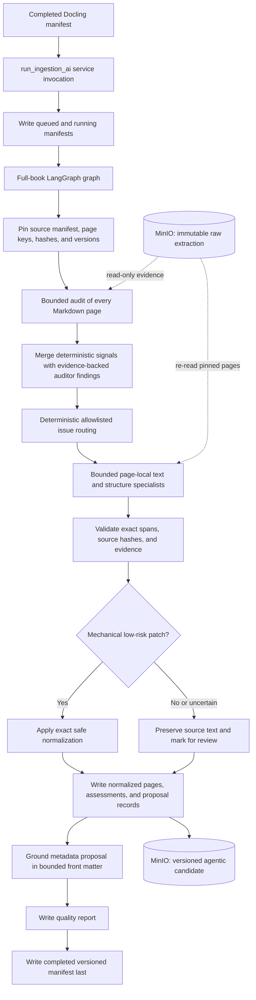

# Book Distiller Ingestion Agentic AI — Architecture

**Status:** The four agent factories, Pydantic contracts, deterministic inventory, single-page audit, full-book LangGraph workflow, safe patch validation, metadata grounding, versioned MinIO artifacts, a dedicated resumable Celery task, manual start/status/resume API, and offline restart/resume tests are implemented. Automatic extraction chaining and live Postgres/Rotator/MinIO evaluation remain pending. No candidate is promoted as an approved active version.
**Last researched:** 2026-11-03.
**Scope:** Improve Docling-extracted PDF/EPUB content before downstream Book Distiller processes. The current focus is text, metadata, and structure quality; VLM-based image understanding is explicitly out of scope.

## Decision

Build a **DeepAgents specialist ecosystem orchestrated by an outer LangGraph workflow**. LangGraph owns the workflow sequence and, once production wiring is added, checkpointed resumption and review interrupts. The current graph runs a fixed sequence with bounded async page processing and deterministic routing. DeepAgents supplies role-specific agents for judgment-heavy work. Ordinary application code remains responsible for MinIO I/O, patch validation/application, and publication invariants.

This is a better fit than either a single autonomous agent editing a whole book or a collection of LLM calls with no durable orchestration. LangGraph's guidance distinguishes fixed workflows from dynamic agents; its `Send` API supports parallel workers with separate inputs. DeepAgents supplies a supervisor/subagent pattern for independent specialist tasks and context isolation. ([LangGraph workflows and agents](https://docs.langchain.com/oss/python/langgraph/workflows-agents), [Send and Command](https://docs.langchain.com/oss/python/langgraph/graph-api-send-command), [DeepAgents subagents](https://docs.langchain.com/oss/python/deepagents/subagents))

## Architecture flow



Page concurrency and model routing are configuration and evaluation decisions. The graph processes every page but does not ask every specialist to rewrite every page. Each model call receives one page or bounded front matter, never the entire book. Manual API/Celery dispatch is implemented; automatic chaining from Docling remains a planned integration step.

## Run lifecycle and storage

### Input and output

Use the `.md` page objects in MinIO as the primary working corpus. Do not re-extract the PDF during this stage. Where they exist, Docling structured JSON, page/figure metadata, and the original PDF are read-only corroborating evidence for ambiguous layout or transcription. They must not silently replace or rewrite the Markdown source.

The current storage convention uses the `coelhonexus` bucket and keys under `bd/books/{book_id}/ingestion/`. Preserve raw extraction objects and write the AI result under a separate immutable version:

```text
coelhonexus bucket
└── bd/books/{book_id}/
    ├── manifest.json
    └── ingestion/
        ├── raw/{extraction_run_id}/
        │   ├── pages/0001.md ...
        │   └── structured/...
        └── agentic/{agentic_run_id}/
            ├── pages/0001.md ...
            ├── assessments/0001.json ...
            ├── patch-proposals/0001.json ...
            ├── book-metadata.json
            ├── quality-report.json
            └── manifest.json
```

`agentic_run_id` is distinct from the Docling `extraction_run_id`; issue a fresh ID for every candidate run. The service rejects an existing run ID so immutable output history cannot be overwritten. The implemented Pydantic manifest contract records the input manifest key/hash, extraction ID, source page keys/hashes, versioned output keys/hashes, workflow/schema versions, status, timestamps, and run error. Keep page assessments, patch proposals, normalized Markdown, metadata, and the quality report as separate artifacts. Add model/prompt versions, review decisions, and gate results as those stages are implemented. Publish the new version only after the run is complete and validated; downstream consumers should resolve an active-version pointer rather than assume the latest candidate is approved.

### Execution

1. **Target behavior is automatic chaining:** when Docling reports a successful, complete extraction and its manifest/page set is finalized, enqueue exactly one idempotent AI run. Failed, cancelled, or incomplete extraction runs do not start the AI stage.
2. During the initial rollout, keep automatic chaining behind a feature flag or shadow mode while validating quality gates; a manual trigger is useful for development and replay. Once enabled for normal ingestion, users should not need to request a second run after Docling finishes.
3. The dedicated Celery worker invokes the LangGraph run graph with a stable run/thread identity and a per-task Postgres checkpointer lifecycle. Worker-loss redelivery reuses that identity; operators can also requeue a failed candidate through the manual API.
4. Each graph node is idempotent and can resume from its own persisted progress. Retry only failed page batches or stages where possible, not the whole book.
5. Keep graph checkpoint state small: object keys, hashes, page numbers/statuses, validated work plans, and compact issue summaries. Fetch page text from MinIO when needed; do not put the full book or large outputs in checkpoints.
6. Only a deterministic publisher writes normalized page objects and the final manifest. Raw pages are never writable through agent tools.

The existing code already has a Celery ingestion task, raw- and agentic-key builders, a FastAPI ingestion route, a structured-chat service, and Postgres checkpointer infrastructure: `apps/server/domains/bd/ingestion/task.py:22`, `apps/server/domains/bd/ingestion/storage/keys.py:68`, `apps/server/entrypoints/api/v1/bd/ingestion/router.py:139`, `apps/server/domains/settings/chat/service.py:421`, and `apps/server/infra/postgres/service.py:95`. Agentic outputs use a separate prefix and never change the raw-prefix convention.

The manual candidate API is separate from extraction: `POST /api/v1/bd/ingestion/{book_id}/agentic/runs` queues a run, `GET /api/v1/bd/ingestion/{book_id}/agentic/runs/{agentic_run_id}` reads its durable manifest status, and `POST .../{agentic_run_id}/resume` requeues a failed run against the same extraction and checkpoint thread. Automatic extraction-to-agentic chaining remains disabled until live evaluation and quality gates are established.

## Agent ecosystem

Each role should have a clear responsibility, a narrow evidence set, a versioned prompt/skill, explicit tools, and a Pydantic response schema. Agent outputs are proposals, not writes.

| Role | Responsibility | Output |
|---|---|---|
| `page_auditor` | Examine every page or bounded page batch with nearby-page context; classify `text`, `blank`, `image_only`, or `mixed`; identify candidate defects. | Page classification and typed issue list. |
| `metadata_normalizer` | Normalize title, subtitle, and author metadata from bounded front-matter evidence; keep source filename separate. | Evidence-grounded metadata proposal; unsupported or low-confidence values fall back to source metadata and require review. |
| `text_repair` | Propose minimal contextual fixes to extracted prose; preserve technical tokens and meaning. | Exact-span patch proposals, not rewritten pages. |
| `structure_repair` | Review headings, TOC, tables, multi-column layouts, and indexes using Markdown evidence. | Exact-span proposals; ambiguous changes remain review-only. |
| `page_auditor` | Examine every page; classify `text`, `blank`, `image_only`, or `mixed`; identify candidate defects. | Evidence-backed typed page assessments. |

The current workflow intentionally uses four narrow DeepAgents rather than adding a separate coordinator or critic: issue-to-role routing is deterministic and allowlisted, while the application enforces evidence, hashes, span uniqueness, and patch policy. Consider independent critic/review agents only after labeled evaluations show a measurable benefit. The current graph uses bounded async page batches within audit and repair nodes; it does not yet use LangGraph `Send` or human interrupts. Restart behavior is tested with LangGraph's in-memory checkpointer; live Postgres recovery still needs an environment-level exercise.

For this non-conversational batch process, avoid permanent memory across books at first. LangGraph checkpointing is for resuming a particular run; it is not a license for an agent to carry one book's corrections into another. The `deepagents/009_memory/README.md` experiments are valuable as a testing and isolation reference, but this workflow should keep per-book evidence isolated.

### Agent tools and security

- Expose scoped read operations such as `read_page`, `read_neighbor_pages`, `read_structure`, and `read_manifest`. Derive book/run scope from trusted server context; do not accept arbitrary MinIO keys from model-generated arguments.
- If using DeepAgents' filesystem abstraction, implement or route to a read-only backend for raw artifacts and allow only read/list/search tools. Deny writes and deletes at both the tool and storage-service layers.
- Give agents no shell, browser, public web, or general-purpose object-store tools. Treat book text as untrusted input and possible prompt injection.
- Do not rely on an agent's confidence or a requested JSON mode as validation. Parse the response into Pydantic, enforce enums and bounds, reject malformed or stale proposals, and verify exact source spans and hashes before applying.
- Preserve protected literals: URLs, IP addresses, hashes, commands, code fences, filenames, emails, and cybersecurity indicators. Reject or escalate a proposal that alters these without explicit source evidence.
- Keep images and figure references intact. This phase does not describe, OCR, or interpret images with VLMs.

DeepAgents supports pluggable filesystem backends and filesystem tool allowlists; its default general-purpose subagent has filesystem tools, so replace or disable it rather than accidentally granting it a broader surface than the named roles. ([DeepAgents backends](https://docs.langchain.com/oss/python/deepagents/backends), [DeepAgents subagents](https://docs.langchain.com/oss/python/deepagents/subagents))

## Page and patch contracts

The exact Pydantic schema should be designed and tested before prompts. At minimum, boundary schemas should represent:

- `PageAssessment`: page number, page kind, findings, severity, confidence, source/evidence references, and whether specialist review is needed.
- `PatchProposal`: input hash, exact source span plus local context, replacement, issue code, rationale, evidence, confidence, protected-token impact, and requested disposition.
- `BookMetadataProposal`: normalized field, value, source page/object, and provenance.
- `WorkPlan`: allowlisted specialist role, page IDs/ranges, issue IDs, required evidence, and bounded work-item count.
- `ReviewDecision`: accepted/rejected/edited/escalated disposition tied to a specific proposal and input hash.

The application applies a patch only if its input hash still matches, the target span matches unambiguously, evidence is an exact source excerpt, and all safety invariants pass. Automatic application is limited to two provably text-preserving classes: removal of soft hyphens or non-whitespace control characters (low risk, confidence ≥ 0.98), and space-only repairs of `split_word`, `fused_marker` and `text_corruption` findings (not high risk, confidence ≥ 0.8) whose target lies inside the issue's own evidence, that change only spaces and soft hyphens (plus added hyphens in plain prose, or a hyphen dangling before a space — never an existing in-word hyphen, digits or punctuation), and that keep leading/trailing whitespace and Markdown list/heading/quote markers intact. Any edit that changes a letter, joins a line break, or touches structure remains review-only. A proposal that appends new words or introduces a link, image path or HTML comment the target did not contain is dropped as invented text, and an invalid target loses only its own proposal. A repair that inserts whitespace is never applied inside a URL, path or address (the unbroken text around it contains `/`, `\` or `@`), and a review-only proposal never blocks a verified repair; only two repairs that could both apply can collide. A verified space-only repair may name a phrase that occurs more than once (it is applied at every occurrence or at none), and a soft-hyphen or control-character finding is resolved against the cleaned text, whoever removed the character. Do not let a specialist return an entire replacement page where a narrow patch is sufficient.

## Findings from “The Art of Cyberwarfare”

The 275-page MinIO Markdown edition provides a concrete first evaluation fixture. These are observed cases from the audit, not a claim that every other page has been exhaustively source-checked.

| Finding | Pages/examples | Architecture behavior |
|---|---|---|
| Verified blank pages | 2, 4, 8, 10, 16, 78, 106, 126, 178, 200, 232, 236, 262 | Mark `blank`; retain page number and record. Downstream text consumers may filter it, but normalization never removes the physical-page entry. |
| Image-only page | 229 | Keep as `image_only`; never misclassify as blank just because Markdown has little/no prose. Preserve figure references for a future media/VLM stage. |
| Control characters | Page 3 | Flag deterministic cleanup; validate output and preserve surrounding text. |
| Split word | Page 5, “Invest igator's” | Propose a local, evidence-backed repair; verify against title-page evidence. |
| Soft hyphens | Pages 37 and 127 | Normalize only with a rule that preserves legitimate hyphenation and source text. |
| TOC noise | Pages 9 and 11–14 | Compare entries/leader noise with the page sequence and headings; avoid flattening meaningful rows. |
| Fragile index/table layouts | Pages 263–273 | Use structured JSON/layout evidence when present; otherwise retain content and route uncertain reconstruction to review or later re-extraction. |
| Fused extraction markers | Pages 189 and 214 | Review against source context; do not guess where markers overlap code or prose. |
| Raw filename as title | Book metadata | Derive display title from title-page/book evidence; retain upload filename separately as source metadata. |

## Quality gates and evaluation

Run a programmatic evaluation suite before enabling promotion. Seed it with the known cases above and add manually verified examples from prose, headings, code, tables, images, and EPUB pages as they become available.

Required invariants and measures:

1. **Completeness:** normalized manifest covers the exact input page set and order; no page disappears.
2. **Page-type correctness:** measure blank vs image-only vs text/mixed classification, with especially strict false-blank tracking.
3. **Patch safety:** each applied patch maps to the intended source span and input hash; rejected/stale proposals never apply.
4. **Content integrity:** measure text retention and exact edit precision; protected literals and code must remain unchanged unless explicitly supported and reviewed.
5. **Metadata quality:** canonical title/author and contents claims have page-level provenance; filename remains separately available.
6. **Structure quality:** measure heading/TOC/table/index correctness; ambiguous multi-column content is escalated rather than silently invented.
7. **Operational quality:** idempotent retries, checkpoint resume, bounded concurrency, latency/token/cost reporting, and no partial version promoted as active.

Use a separate critic as an additional signal, never as the only validator. Calibrate confidence thresholds against labeled examples; do not choose acceptance thresholds from one book alone. Human review is required for low-confidence changes, conflicting agents, substantial rewrites, protected-literal edits, and fragile tables/indexes.

## Mapping to `AIAgentsStudies/`

Use the study repository as the implementation reference, not as a copy-paste runtime:

- `AgenticMath/ai/agents/service.py:18`–`77` demonstrates role-specific declared subagents and a root `create_deep_agent` factory, with prompts, skills, tools, and middleware separated.
- `AgenticMath/ai/graphs/graph.py:8`–`15` demonstrates a clear `StateGraph` builder and checkpointer boundary; `states.py` defines the graph state.
- `deepagents/009_memory/README.md` demonstrates executable probes, permission-isolation tests, and the danger of trusting an agent's self-report.
- Do **not** copy the AgenticMath OpenShell/shell execution surface into BD. Its agents run experiments and generate code; BD agents inspect book content and must not execute book text or write source objects.

The `apps/server/ai/bd/` implementation contains Pydantic agent-boundary contracts, deterministic inventory, single-page audit, four DeepAgent factories, and the full-book graph. The full run reads every source page from canonical raw keys, audits with bounded concurrency, routes findings deterministically, validates source-bound proposals, applies only safe mechanical edits, normalizes metadata from bounded front matter, writes per-page artifacts and a quality report, and writes the completed manifest last. Raw pages remain unchanged. Checkpoint state contains references, hashes, findings, and compact proposal summaries—not full Markdown. The auditor and specialists use COELHO LLM Rotator factories with no model-visible tools and denied filesystem permissions. `apps/server/domains/bd/ingestion/ai/service.py:run_ingestion_ai` can invoke the workflow; `apps/server/domains/bd/ingestion/ai/task.py` provides the manual Celery task and Postgres saver lifecycle; the ingestion API exposes manual start, status, and failed-run resume endpoints. Offline tests cover fake-agent workflow recovery and task wiring. Automatic dispatch after Docling extraction is not yet enabled, and no live Rotator/MinIO run has been made. Follow `docs/CODE-CONVENTIONS.md`: Pydantic for boundaries, `TypedDict` graph state, thin graph nodes, imports at file scope, and pure validation separate from I/O.

Suggested learning/build sequence:

1. Define the versioned agentic run manifest, page artifact references, and graph-state boundary; implemented. The graph state holds references and compact results, never full Markdown.
2. Build the full-book LangGraph workflow with bounded page processing, deterministic routing, specialist proposals, validation, and immutable output persistence; implemented and fake-tested.
3. Add metadata, text-repair, and structure-repair agents; use deterministic code for work routing and patch safety rather than adding planner/reviewer agents initially; implemented.
4. Add automatic chaining after successful Docling extraction, with idempotent dispatch and a rollout flag; manual dispatch, durable status, explicit failed-run resume, and the production checkpointer task lifecycle are implemented.
5. Run one end-to-end book through the complete workflow with live Postgres/Rotator/MinIO, review the derived artifacts, and only then enable automatic processing with quality gates; not yet performed.

## Current integration and version notes

Existing extraction is Docling-based and stores page Markdown plus structured evidence; see `docs/BD-INGESTION-2026-11-02.md` and `apps/server/domains/bd/ingestion/extract/service.py:37`.

As researched on 2026-11-03, official releases listed LangChain 1.4.8, LangGraph 1.2.19, and DeepAgents 0.7.32. The server lock resolves DeepAgents 0.6.8, LangGraph 1.2.16, and LangChain 1.4.6; `AIAgentsStudies/pyproject.toml` has newer minimums. Validate the production image's pinned dependency set against the implemented factories and checkpointer before live rollout. DeepAgents remains pre-1.0/beta, so pin versions and isolate its integration behind the agent factory. ([LangChain releases](https://github.com/langchain-ai/langchain/releases), [LangGraph releases](https://github.com/langchain-ai/langgraph/releases), [DeepAgents releases](https://github.com/langchain-ai/deepagents/releases), [DeepAgents release policy](https://github.com/langchain-ai/docs/blob/main/src/oss/release-policy.mdx))

## Primary references

- [LangGraph workflows and agents](https://docs.langchain.com/oss/python/langgraph/workflows-agents)
- [LangGraph graph API and `Send`/`Command`](https://docs.langchain.com/oss/python/langgraph/graph-api-send-command)
- [LangGraph persistence](https://docs.langchain.com/oss/python/langgraph/persistence)
- [LangGraph interrupts](https://docs.langchain.com/oss/python/langgraph/interrupts)
- [LangChain structured output](https://docs.langchain.com/oss/python/langchain/structured-output)
- [DeepAgents overview](https://docs.langchain.com/oss/python/deepagents/overview)
- [DeepAgents subagents](https://docs.langchain.com/oss/python/deepagents/subagents)
- [DeepAgents backends](https://docs.langchain.com/oss/python/deepagents/backends)
- [Docling document model](https://docling-project.github.io/docling/concepts/docling_document/)
- [Docling serialization](https://docling-project.github.io/docling/concepts/serialization/)
