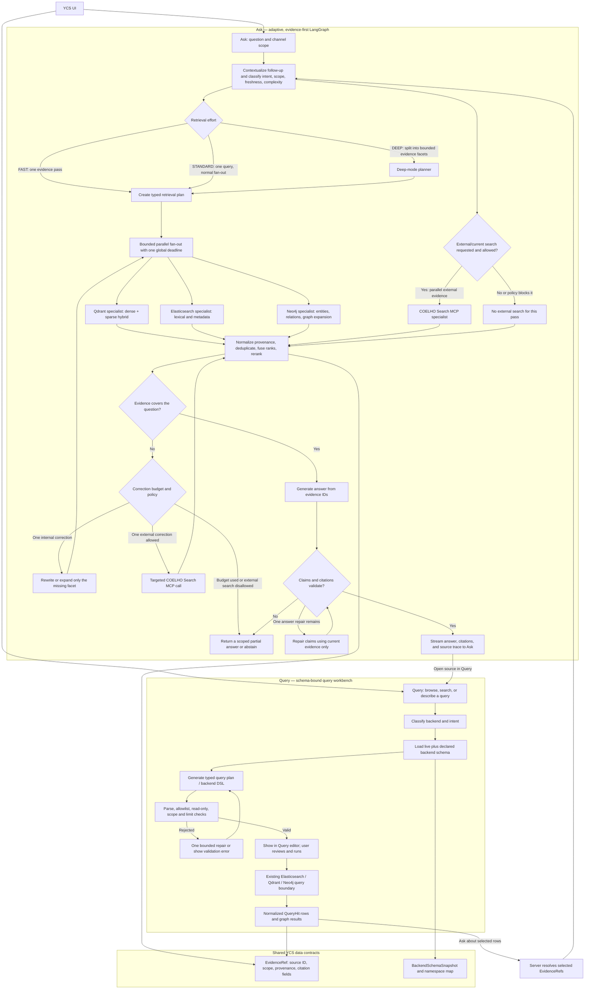
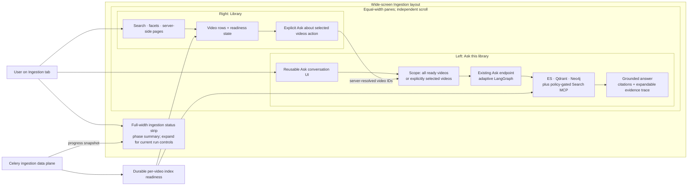
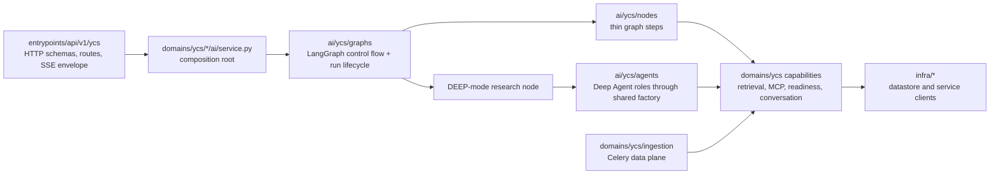

# YCS Agentic RAG Architecture — SOTA review (2026-11-08; implementation-plan updates 2026-11-09)

**Status:** proposed architecture; no application code changed by this review.
**Scope:** YCS Ask, YCS Query, Elasticsearch, Qdrant, Neo4j, and the planned COELHO Search MCP router.

## Decision

Build a **LangGraph-owned, adaptive retrieval workflow** with four separately owned specialist lanes: Qdrant, Elasticsearch, Neo4j, and COELHO Search MCP. Give each lane a narrow input/output contract, independent timeout and telemetry, and access only to its own backend capability.

Use **Deep Agents selectively** for bounded work that benefits from model planning or context isolation, such as Deep-mode question decomposition and evidence review. Keep backend calls and Query DSL validation as deterministic services. This follows the current YCS experience and the project’s existing separation between graph control flow, thin nodes, pure domain logic, services, prompts, and agent builders.

Treat each of the four specialists as an independently governed capability in the graph, with its own tool boundary and result contract. Keep Qdrant, Elasticsearch, and Neo4j retrieval as direct bounded service calls; use a Deep Agent inside a specialist only when evaluation shows that the backend task needs iterative planning. Query DSL generation should remain a schema-grounded structured model call followed by deterministic validation.

Connect Ask and Query through shared, server-owned evidence and schema contracts:

- **Ask** turns a question into a grounded answer with source-linked citations.
- **Query** turns a user’s request into a schema-bound backend query, previews it in the editor, and runs it only through the existing backend-specific query boundary.
- Both use the same backend adapters, namespace definitions, and evidence identifiers. Query result selections can seed an Ask; Ask citations can open a corresponding record or search in Query.

Keep the current Ask API and Query routes as the compatibility boundary while the new orchestration is introduced behind a feature flag. Promote it only after a YCS-specific evaluation set shows quality and latency trade-offs.

## Why this fits YCS

YCS already has substantial pieces to build on:

- Ask already has FAST, STANDARD, and DEEP paths, question contextualization, bounded multi-question fan-out, synthesis, and a critic.
- Ask already has Elasticsearch, hybrid dense/sparse Qdrant, and Neo4j retrievers behind a common retrieval interface. It also has a Parallel MCP fallback for low-evidence cases.
- Query is a separate workbench: it offers simple and raw searches against Elasticsearch, Qdrant, and Neo4j; live plus declared schema context; AI text-to-DSL; safety checks and a repair attempt; backend history; and result inspection.
- Ask and Query already instrument different workflows. Keep those user-facing contracts and telemetry names stable as the implementation evolves.

The architecture should extend those capabilities, rather than create a second copy of the retrievers or replace Query with a conversational answer agent. The planned Search MCP lane should replace the direct provider-specific web-search dependency in Ask with the COELHO router, while leaving provider choice and provider-specific API details behind that MCP boundary.

One important Ask rule: a factual answer presented as corpus-grounded must pass through retrieval. A low-cost FAST route can use one retrieval wave and one answer call; it should not mark a parametric-only answer as grounded. For a conversational or out-of-corpus request, state the answer’s scope explicitly or route it through approved external search.

## Main flowchart



The graph’s retrieval effort is adaptive, but its external behavior is bounded. A normal Ask request uses one planned wave. Deep mode creates a small fixed number of facets and uses the same four specialist lanes. Only an explicit external/freshness need or a policy-approved low-evidence correction can call Search MCP. Each graph run has one total deadline and at most one targeted correction round.

## Ingestion integration: build the corpus, then serve it

Keep ingestion as a separate, deterministic data plane. It produces versioned evidence for the online Ask and Query workflows; it should not become another LLM agent loop. LangGraph starts when a user asks a question or asks Query to draft a backend query. Celery (or a future durable workflow runner) handles the long-running extraction and index materialization.

### What the current YCS code actually does

The implementation is already streaming and per-video, not a single batch-wide `Playwright → Elasticsearch → Qdrant → Neo4j` chain:

1. `extract_videos` gets metadata through yt-dlp and writes it to Elasticsearch. Playwright then fetches or reuses each transcript. Each transcript is written to Elasticsearch and refreshed before its callback fires.
2. As each transcript becomes visible in Elasticsearch, `_on_video_indexed` dispatches Qdrant work for that video and adds the video to a bounded Neo4j task chunk. Qdrant and Neo4j therefore materialize concurrently while extraction continues. Qdrant chunks and embeds per video, buffering point writes; Neo4j extracts graph data from chunks of videos and runs entity resolution once when its phase is complete.
3. Redis counters aggregate the streaming work for the UI. A `SET NX` guard lets one caller invalidate the Ask cache after both index phases finish. That guards finalization; it does not provide exactly-once task execution.

This behavior is implemented in [extract/service.py](../apps/server/domains/ycs/ingestion/extract/service.py), [pipeline_task/service.py](../apps/server/domains/ycs/ingestion/pipeline_task/service.py), [qdrant_task/task.py](../apps/server/domains/ycs/ingestion/qdrant_task/task.py), and [neo4j_task/service.py](../apps/server/domains/ycs/ingestion/neo4j_task/service.py). Preserve the early per-video fan-out and the bounded Neo4j chunking: the code comments document real worker-pool starvation when Neo4j was dispatched one video per Celery task.

### Recommended target

Keep the ingestion workflow deterministic and reuse the existing Celery tasks first. Give it a durable run/item manifest and versioned materialization events so missed dispatches and partial sink failures can be reconciled. Keep Redis as the fast progress projection; do not make its expiring counters the only record of whether a video revision reached each index.

For every selected video, track a stable `content_revision` (transcript and metadata fingerprint) plus a `materialization_revision` for the chunker, embedding model, graph extraction schema/prompt, and relevant index mapping versions. Record readiness independently for Elasticsearch, Qdrant, and Neo4j. Ask and Query receive that readiness vector and search only the backends that have the requested revision. This allows a partial but correctly labeled result when one projection is still processing or failed.

Dispatch each materialization with an idempotency key such as `(video_id, content_revision, sink, materialization_revision)`. Use deterministic Qdrant point IDs and Neo4j `MERGE`/version guards; persist the source revision and chunk/segment IDs on every evidence record. A retry may repeat work, but it must converge to the same index state. Avoid claiming exactly-once delivery across Elasticsearch, Redis/Celery, Qdrant, and Neo4j: the stores do not share a transaction.

Because Elasticsearch writes and Celery publication are separate side effects, add a durable dispatch ledger/outbox and a reconciler. The writer records each expected sink operation; a dispatcher publishes pending operations to Celery; workers update per-sink status. A periodic reconciler compares the manifest with searchable Elasticsearch transcript revisions and materialized Qdrant/Neo4j revisions, then requeues only missing or failed work. If a crash happens between the Elasticsearch refresh and durable event recording, reconciliation can rediscover the indexed revision. Duplicate events are safe because workers are idempotent. The outbox pattern addresses the state/message dual-write gap; the reconciler covers the Elasticsearch-to-ledger gap.

The readiness contract should report one of `ready`, `partial`, `processing`, or `failed` for each video revision, with a set of usable backends and structured sink errors. Publish a new active revision only after the configured serving policy is met. Keep the previous active revision available during re-ingestion when possible; switch the active pointer after the new materialization is ready, then invalidate or version Ask’s cache. If policy allows partial availability, expose that explicitly and let Ask/Query use only the ready backends. Do not let stale Qdrant chunks or graph facts masquerade as the new transcript revision.

### Integrated system chart

```mermaid
flowchart LR
    PICK["Select N videos"] --> RUN["Create IngestRun + per-video revision manifest"]
    RUN --> EXTRACT["yt-dlp metadata + Playwright transcript fetch/cache"]

    subgraph INDEXES["Materialized YCS indexes"]
        ES[("Elasticsearch<br/>metadata + searchable transcripts")]
        QD[("Qdrant<br/>hybrid transcript chunks")]
        N4J[("Neo4j<br/>video, channel, entity graph")]
    end

    EXTRACT -->|"metadata"| ES
    EXTRACT -->|"transcript; refresh before callback"| ES
    ES --> EVENT["Transcript committed<br/>callback today; versioned event target"]
    EVENT --> DISPATCH["Celery task dispatch<br/>direct callback today; outbox target"]
    EVENT -. "target: persist dispatch intent" .-> LEDGER
    LEDGER -. "target: publish pending outbox work" .-> DISPATCH
    DISPATCH -->|"per video"| QBUILD["Chunk → embed → deterministic upsert"]
    DISPATCH -->|"bounded video chunk"| GBUILD["Metadata graph + LLM entity extraction"]
    QBUILD --> QD
    GBUILD --> N4J
    QBUILD --> LEDGER
    GBUILD --> LEDGER
    N4J --> RESOLVE["Run-level entity resolution"]

    subgraph CONTROL["Durable ingestion control (target) / current UI progress"]
        LEDGER["Run + item ledger<br/>content_revision, build versions,<br/>per-sink state, attempts, errors"]
        RECON["Reconciler<br/>find and requeue missing sink work"]
        REDIS["Redis progress projection<br/>current counters and polling state"]
        READY{"Per-video serving policy"}
        ACTIVE["Active evidence revision<br/>ready backend set + provenance"]
        PARTIAL["Partial / processing / failed<br/>with explicit usable backends"]
        CACHE["Revision-keyed cache / scoped invalidation"]
    end

    RUN --> LEDGER
    EXTRACT --> LEDGER
    ES --> LEDGER
    QD --> LEDGER
    RESOLVE --> LEDGER
    LEDGER --> REDIS
    LEDGER --> READY
    READY -->|"required indexes ready"| ACTIVE
    READY -->|"still building or allowed partial"| PARTIAL
    ACTIVE --> CACHE
    PARTIAL --> CACHE
    LEDGER --> RECON
    RECON -. "replay only missing or failed work" .-> DISPATCH
    REDIS --> INGEST_UI["Ingestion progress UI"]

    subgraph SERVING["Online YCS serving plane"]
        ASK["Ask question"] --> PLAN["LangGraph: scope, freshness, effort"]
        PLAN --> AVAIL["Read active revision + ready backend set"]
        AVAIL -->|"ready"| ESREAD["Elasticsearch specialist"]
        AVAIL -->|"ready"| QREAD["Qdrant specialist"]
        AVAIL -->|"ready"| NREAD["Neo4j specialist"]
        PLAN -->|"external/current request or allowed correction"| MCP["COELHO Search MCP"]
        ESREAD --> EVIDENCE["Evidence packet<br/>EvidenceRefs + revision + source provenance"]
        QREAD --> EVIDENCE
        NREAD --> EVIDENCE
        MCP --> EVIDENCE
        EVIDENCE --> ANSWER["Grounded answer + validated citations"]

        QUERY["Query workbench"] --> QPLAN["Schema + readiness-aware query plan"]
        AVAIL --> QPLAN
        QPLAN --> VALIDATE["Read-only, scope, allowlist, limit checks"]
        VALIDATE --> REVIEW["User reviews and runs query"]
        REVIEW --> HITS["Backend results with EvidenceRefs"]
        HITS -->|"selected rows seed Ask"| ASK
        ANSWER -->|"inspect cited source"| QUERY
    end

    CACHE --> AVAIL
    ES -. "read path, readiness-gated" .-> ESREAD
    QD -. "read path, readiness-gated" .-> QREAD
    N4J -. "read path, readiness-gated" .-> NREAD
```



In this chart, the per-video callback and Celery tasks are the current path. The durable ledger, outbox dispatch, reconciler, and revision-aware availability checks are the recommended reliability layer. Redis remains useful for fast progress polling, but sink readiness should survive its TTL and let a later repair resume only the incomplete work.

### Ingestion tab: Ask beside the Library

The proposed 50/50 desktop split makes sense. The left pane should be an **Ask this library** conversation that reuses the existing Ask API, conversation behavior, and LangGraph. Keep Elasticsearch, Qdrant, Neo4j, and Search MCP as bounded capabilities behind that conversation. Show citations and a compact activity/evidence trace, with detailed specialist results available on demand.

On wide screens, use equal-width columns with independent vertical scrolling. Keep the Library searchable and server-paginated so the complete corpus remains available without rendering every row at once. On narrow screens, stack the panes or make them switchable so the Library remains usable. Keep active ingestion controls in a compact full-width status strip above the split, with the existing detailed progress/actions expandable from it.

Default Ask scope should be **all videos whose active index revision is ready**. Add an explicit “Ask about selected videos” action to make selection scope clear. Enforce exact-video scope in all three local retrievers and lock it with the thread, just as channel scope is locked today. Label a video that is still processing as unavailable or partial, and cite only evidence backed by ready indexes. The selected-video UI should ship with the server-side scope contract and readiness API described below.



### Target module ownership and dependency flow

The repository already has the `ai/ycs/` package roots, but they currently contain only `__init__.py` scaffolding. Build only the packages required by each shipped slice; use BD/DD as the live examples for Deep Agent factories, LangGraph subgraphs, nodes, and domain composition roots.

```text
apps/server/ai/ycs/
├── agents/service.py                 # one shared Deep Agent factory
├── agents/ask/deep_researcher/       # bounded DEEP-mode supervisor role
├── agents/ask/facet_researcher/      # context-isolated subagent, if the role delegates
├── agents/ask/evidence_reviewer/     # add only if evaluation warrants a reviewer agent
├── graphs/ask/                       # LangGraph topology, graph state/context, Ask runner
├── graphs/ask/runner/                # stream/run lifecycle and graph event handling
├── nodes/ask/<step>/                 # thin node.py + service.py/domain.py as triggered
├── prompts/ask/<role>/               # prompts.py + SYSTEM.md; no prompts in domains/
├── tools/ask/                         # narrow wrappers only when an agent needs tool calling
├── middlewares/                       # shared tool and resilience policies, when needed
└── graphs/query/ + nodes/query/       # add for the schema/validate/one-repair workflow

apps/server/domains/ycs/
├── ask/ai/service.py                 # composition root: bind ai graph to runtime dependencies
├── ask/retriever/                    # existing ES/Qdrant/Neo4j I/O adapters
├── ask/search_mcp/                   # COELHO Search MCP client/service boundary
├── ask/{conversation,cache,runtime,observability}/
├── query/                            # schema, safety, backend execution, history
└── ingestion/                        # existing Celery extraction and index materialization

apps/server/entrypoints/api/v1/ycs/
├── agents/                            # existing Ask HTTP/SSE contract during migration
└── query/                             # existing Query URL contract
```



`entrypoints/` owns transport and wire validation, then calls a domain service. The `domains/<context>/<feature>/ai/service.py` module is the only composition root that binds `infra`, settings-backed models, domain adapters, callbacks, and the graph. `ai/ycs/` owns graph control flow, nodes, Deep Agent roles, and prompts; it may use domain capabilities through injected context, and it never imports `infra`. Domain retrievers and Query services keep data access and deterministic policy. The ingestion batch remains a Celery data plane; LangGraph starts on the online Ask/Query path.

Keep the current `/agents` and `/query` URL contracts while moving the implementation. The package path currently matches those router paths. A later URL rename to `/ask` is a separate API migration: route package and URL must move together, then OpenAPI and the generated web client must be updated.

### Code-first implementation plan

Ship the following PR-sized slices in order. Each slice keeps the existing YCS behavior available until its replacement is shown equivalent.

1. **Freeze the current public and persisted contracts.** Capture Ask sync/stream request shapes, SSE event names and payloads, `thinking_state`, thread scope locking, Query AI stream shapes, pipeline progress endpoints, Redis keys, Celery task names, citations, and cancellation. Record current Ask/Query quality, latency, and cost as the comparison baseline.
2. **Move graph construction and run binding behind the domain boundary.** Add `domains/ycs/ask/ai/service.py` as the YCS composition root, following `domains/dd/pipeline/ai/service.py`. Move graph construction, infrastructure-backed callback creation, and cancellation/progress bindings out of `entrypoints/api/v1/ycs/agents/`; have the route call the domain service and frame its event stream as SSE. Put graph run/stream lifecycle in the AI graph runner and cancellation/progress state in `domains/ycs/ask/runtime/`. Preserve `/agents`, request/response fields, and event format.
3. **Define shared domain contracts.** Formalize `RetrievalScope`, `IndexReadiness`, `SpecialistResult`, and `EvidenceRef` at a YCS domain boundary shared by Ask and Query. Keep Elasticsearch, Qdrant, Neo4j, conversation persistence, and the COELHO Search MCP client behind domain services. This PR establishes inputs/outputs; it does not change index-readiness behavior yet.
4. **Harden the ingestion data plane.** Add run/item revision records, per-sink status, idempotency keys, deterministic Qdrant point IDs, Neo4j revision guards, durable dispatch intent, and a reconciler. Backfill/reconcile current library rows and dual-write readiness beside the Redis progress projection. Publish the active revision only when the configured serving policy is met.
5. **Make retrieval scope and readiness real.** Extend the Elasticsearch, Qdrant, and Neo4j adapters to filter exact video IDs and active revisions, including transcript partitions and graph provenance. Return typed status and source identifiers. Keep empty, processing, partial, stale, timeout, and backend-error outcomes distinct; resolve IDs and readiness server-side.
6. **Create the minimum `ai/ycs` Ask graph package.** Reconcile the generic convention's `state.py` naming with the live BD/DD `states.py` pattern in `CODE-CONVENTIONS.md`; use `states.py` to match the AI package being extended. Add typed graph state and dependency context, then compile the current FAST/STANDARD/DEEP topology under `ai/ycs/graphs/ask/`. Keep builders declarative and free of I/O. Preserve graph inputs, outputs, recursion/deadline behavior, and streamed node events while moving one subgraph at a time.
7. **Move Ask nodes and prompts into `ai/`.** Classify modules instead of moving `domains/ycs/ask/rag/` wholesale. Move graph topology/node orchestration, model calls, and prompts from the current `rag/`, `grader/`, and prompt-bearing retrieval code into `ai/ycs/graphs/ask/`, `ai/ycs/nodes/ask/`, and `ai/ycs/prompts/ask/`. Keep pure graph-step decisions in adjacent `domain.py`, LLM orchestration in `service.py`, and `node.py` as a 20–40 line LangGraph shell. Keep retrieval, conversation persistence, cache, readiness, MCP transport, and observability adapters in `domains/`.
8. **Add Deep Agents through one YCS factory.** Mirror `ai/dd/agents/service.py::build` and its structured `service.ask` path for model selection, role config, tool allowlists, and resilience middleware. Start with a `deep_researcher` role invoked only by the DEEP path; let it delegate bounded question facets using narrow retrieval tools and return evidence references. Add a separate reviewer role only if evaluation shows a benefit. Give each role its own `agent.py`, `config.py`, `params.py`, prompt package, and optional procedural skill. Keep Qdrant, Elasticsearch, Neo4j, and Search MCP as typed capabilities behind graph nodes/tools, and add a backend-specific Deep Agent only when measured work needs iterative backend reasoning.
9. **Add COELHO Search MCP behind its domain adapter.** Replace the direct Parallel MCP fallback only after local retrieval capabilities are stable. Expose one bounded, policy-gated AI capability; preserve provider choice, credentials, timeouts, and egress controls server-side.
10. **Move Query AI behind the same layer boundaries.** Keep query schema discovery, deterministic validation, safe execution, and history in `domains/ycs/query/`. Put model prompts and structured DSL generation in `ai/ycs/nodes/query/`; add a small LangGraph generate→validate→one-repair flow when that conditional flow is warranted. Query returns a draft for the editor; a separate user action invokes the domain execution service.
11. **Connect the Ingestion UI and Ask/Query handoff.** Extract a reusable Ask conversation surface, add it to the left pane, and keep the paginated Library on the right. Send selected video IDs through `RetrievalScope`; the server resolves readiness and locks scope to the thread. Query selections and Ask citations use server-resolved `EvidenceRef`s.
12. **Canary the graph and remove migration scaffolding.** Run the compatibility suite, existing AI/domain/API architecture checks, YCS UI flows, and the evaluation set. Compare the old and new graph behind a feature flag, canary, then switch the default after quality and operational gates pass. Remove old graph modules and temporary adapters only after all imports and runtime consumers have moved. Upgrade LangGraph/Deep Agents separately from this migration.

### Code-organization rules for these slices

- Mirror the existing `ai/bd` and `ai/dd` package shape. Use the shared `ai/ycs/agents/service.py` factory for every `create_deep_agent` role; keep role agents, config, prompts, middleware, and tools in their matching `ai/ycs/` packages.
- Keep LangGraph state `TypedDict`s in `states.py` only, matching `ai/bd` and `ai/dd`. Keep internal contracts and dependency contexts as dataclasses in `entities.py`; use Pydantic schemas at HTTP, LLM, and external-service boundaries.
- Keep graph compilation free of network, datastore, model, and environment I/O. Pass model clients, retrieval adapters, checkpointers, and run context through the graph context; set up and release checkpointers at the composition/run boundary.
- Keep `ai/` free of `infra` imports. Domain services own backend calls, MCP transport, thread persistence, readiness, storage access, and cancellation/progress state; the domain composition root binds those services to the AI graph.
- Keep `domain.py` pure, `service.py` as the I/O shell, and `node.py` thin. Add `params.py` and `__init__.py`/`__all__` per the live module convention; add `prompts.py`, `schemas.py`, `entities.py`, `state(s).py`, `keys.py`, or `versions.py` only when their documented trigger applies.
- Keep routes in the URL-matching `entrypoints/api/v1/ycs/<feature>/` package. Routers validate transport input and call domain services; they do not build graphs, open clients, or know Redis key layouts. Treat any URL change as a coordinated route/OpenAPI/client migration.
- Use dotted `domains.*` and `ai.*` cross-package references with module-only re-exports. Keep Query and Ask from importing each other’s routes or feature services; share capabilities through YCS domain contracts/adapters.

### Workflow engine boundary

| Component | Role in YCS | Recommendation |
|---|---|---|
| **LangGraph** | Online Ask routing, bounded retrieval waves, evidence sufficiency, answer verification, streaming/checkpointing. | Keep it on the request-time RAG path. Its nodes can retry or resume, so any side effects still need idempotency. |
| **Celery** | Existing asynchronous extraction, Qdrant materialization, and Neo4j materialization. | Keep it for the current implementation; add durable per-video state, idempotent tasks, and reconciliation before changing runtimes. |
| **Temporal** | Alternative durable workflow runtime with persisted execution history and activity-level retry/recovery. | Evaluate only if YCS needs long-lived resumable runs, durable waits/signals, or recovery guarantees that the Celery + ledger design cannot meet. It adds a new service to operate. |
| **Deep Agents** | Context isolation and subagent planning for selected LLM-heavy tasks. | Do not use it to fetch transcripts, embed chunks, write indexes, or track the N-video batch. Those steps are deterministic data work. |

Current Celery guidance requires idempotent task behavior when late acknowledgements can cause redelivery. LangGraph can re-run a failed node from its beginning, so its external side effects also need idempotency. Temporal provides stronger durable workflow history, but it does not make external writes exactly once; activity effects still need idempotency. The practical YCS choice is therefore to harden the current Celery plane and keep the workflow contract independent of the runner. Move that contract to Temporal only if operational evidence justifies the additional runtime.

The dispatcher is not an LLM planner. Let deterministic rules decide that a transcript revision fans out to Qdrant and Neo4j; let each worker do its bounded backend job. LLMs remain inside the Neo4j entity/relationship extraction task where semantic extraction is the actual work, and inside Ask where they plan and synthesize answers.

For freshness, `apps/server/uv.lock` currently resolves Celery **5.6.3**; upstream Celery **5.7.0** was released on 2026-11-05. Keep this architecture change separate from a Celery lock upgrade. Temporal is an option rather than a proposed dependency: the current server release line and Python SDK are actively maintained, but YCS does not need to adopt them to add the manifest, idempotency, and reconciliation contracts.

## Specialist responsibilities

| Specialist | Ask responsibility | Query relationship | Boundary |
|---|---|---|---|
| **Qdrant** | Retrieve transcript chunks with the existing dense+sparse hybrid query and metadata filters. Return ranked chunks and stable video/chunk provenance. | Query’s Qdrant tab stays a workbench. Ask and Query share collection and payload definitions, not response semantics. | One bounded hybrid retrieval call. Do not expose arbitrary collection selection to the Ask model. |
| **Elasticsearch** | Retrieve exact terms, title/channel matches, and transcript text. Use the existing indices and metadata fetch path. | Query keeps its simple and raw Elasticsearch paths. Its schema service is shared with the Query planner. | Read-only, scoped indices; return rank and source identifiers, not raw engine internals. |
| **Neo4j** | Expand entity, channel, and relation context for multi-hop questions; return supporting source/video IDs with each graph fact. | Query keeps its graph inspection and Cypher workbench. Ask can open a supporting graph record in Query. | Parameterized, allowlisted read queries. Graph facts without source anchors are context, not sufficient citation evidence. |
| **COELHO Search MCP** | Search outside YCS when the user asks for current/external information or an evidence gate permits a targeted web correction. | Query can optionally expose external-search results as a separate source view later; it should not silently mix them into backend DSL results. | One MCP gateway owns routing to providers. Ask sees a stable search contract, provider IDs, URLs, dates when supplied, and bounded snippets. |

These are four independent specialist lanes with separate ownership and observability. The Qdrant, Elasticsearch, and Neo4j lanes should initially call their existing retrieval services directly. Their normal job is a bounded database operation; adding a separate LLM loop around each database call adds cost and failure modes without improving retrieval by itself. A lane can become a Deep Agent later if a measured use case needs iterative, backend-specific reasoning.

## Ask retrieval and answer contract

Use typed, validated outputs between graph nodes. Suggested internal shapes:

- **RetrievalPlan:** original question reference, channel scope, freshness requirement, retrieval mode, a bounded list of facets, allowed specialists, and whether external search is allowed.
- **SpecialistResult:** specialist name, status (ok, empty, timeout, error, or skipped), elapsed time, requested query, ranked results, and a compact error code.
- **EvidenceRef:** opaque evidence ID, backend, source ID, video/channel ID, chunk or graph-record ID, title, URL, excerpt, timestamp if available, rank, and retrieval query.
- **AnswerDraft:** answer text plus claims mapped to one or more EvidenceRef IDs. The final citation formatter resolves those IDs server-side.

Never merge raw Qdrant, Elasticsearch, Neo4j, or web scores as if they shared a scale. Qdrant already performs dense/sparse hybrid fusion internally. Across specialist result lists, begin with rank-based RRF, deduplicate by canonical source/chunk identity, then apply the existing reranker or a calibrated cross-encoder if evaluation demonstrates a gain. Tune source weights only on YCS judgments; preserve a neutral RRF baseline.

The evidence gate checks coverage of the planned facets, relevance, provenance, conflicts, and whether the answer is supported by source text. If a facet is missing, the graph may make one targeted correction: rewrite that facet, run graph expansion, or use COELHO Search MCP when external search is permitted. If it is still unsupported, produce a scoped partial answer or say the corpus did not establish it. The answer verifier may request one repair, never an open-ended search loop.

Preserve source distinctions in the answer: transcript evidence and external web evidence have separate labels and citations. Search results are untrusted content. They cannot change tool permissions, the retrieval plan, or the user’s data scope. The citation formatter only accepts IDs present in the server’s evidence packet.

## Ask and Query integration

Ask and Query should share infrastructure and provenance while keeping separate user goals:

1. **Shared backend schema:** use Query’s live-plus-declared schema provider and namespace map as the source of truth for backend names, searchable fields, and supported apps. Ask’s tools still expose only the narrow retrieval calls they need.
2. **Shared data adapters:** keep database I/O in YCS domain services or infra adapters. Both features call those services; neither reaches into the other feature’s route layer.
3. **Ask → Query:** every Ask citation has a stable source target. “Inspect in Query” opens the appropriate backend and a safe prefilled lookup when that source can be addressed there.
4. **Query → Ask:** Query selections pass server-resolvable EvidenceRef IDs, not client-authored snippets. Ask can answer a question over those selected records and the chosen channel scope.
5. **Query AI remains a query authoring feature:** it loads schema context, returns a typed backend query, passes deterministic read-only/scope/limit validation, shows the result in the editor, and waits for the user to run it. Raw mode remains an advanced user-controlled workbench.

This creates a shared evidence loop without forcing Ask to emit raw DSL or Query to generate prose answers.

## Orchestration and code organization

Follow the target ownership tree and code-first sequence above. The core division is: LangGraph controls online request flow; Deep Agents provide context-isolated, bounded multi-step research in DEEP mode; domain services own retrieval, MCP transport, conversation persistence, readiness, and query safety; the domain composition root binds them to infrastructure; API entrypoints keep the existing wire contracts.

Use separate Elasticsearch, Qdrant, Neo4j, and Search MCP capability contracts, with each capability returning typed status and provenance. Initially implement the local database specialists as bounded read-only graph nodes over the existing domain retrievers. A Deep Agent may call narrow wrappers around those capabilities in a genuinely multi-step research task. This preserves distinct ownership without adding an LLM planning loop around each ordinary database read. Search MCP remains one policy-gated external capability routed through COELHO; provider credentials and provider choice stay server-side.

Build the new Ask path alongside the current path behind a feature flag. Keep old and new graph inputs, outputs, citations, API events, and persistence behavior comparable. Move Query AI after the Ask graph and capability contracts stabilize. Keep the ingestion task graph and its storage side effects in the existing deterministic Celery domain, with any LLM prompt-specific extraction isolated under `ai/ycs/` as described above. Remove migration modules after imports and runtime traffic have moved; treat dependency upgrades and API URL changes as separate releases.

## Reliability, security, and observability

- **Partial results:** classify empty, timeout, error, and skipped distinctly. One failed specialist must not discard successful evidence or hold the run indefinitely.
- **Deadlines:** use one global request deadline, a smaller per-specialist deadline, a concurrency semaphore, and a maximum facet count. Cancel unfinished work after the deadline and report its status.
- **Retries:** retry only transient transport/provider failures. Bound query correction separately from transport retries; never retry a rejected or unsafe query unchanged.
- **Checkpointing:** use a durable YCS-compatible checkpointer for resumable long runs once lifecycle and cancellation semantics are verified. Ask currently accepts an unused checkpointer in the adaptive graph, so checkpointing must be explicitly implemented and validated rather than assumed.
- **Conversation memory:** keep the existing conversation service as the source for thread history. The graph receives only the context needed for the current turn; do not use full conversation history as a substitute for retrieval evidence.
- **MCP:** use the COELHO gateway as one read-only capability with tool allowlists, egress policy, provider budgets, timeouts, output-size caps, and untrusted-result handling. Confirm that the MCP client and gateway negotiate the current protocol revision or a supported legacy revision.
- **Tracing:** record graph run ID, Ask thread ID, node/specialist, backend, query hash, selected scope, latency, candidate count, status, correction count, model/cost, and citation IDs. Do not put credentials or complete prompts/results in metrics labels.

## Evaluation and rollout gates

Build an adjudicated YCS evaluation set before changing default behavior. Include single-hop transcript lookup, multi-hop entity questions, channel-scoped questions, ambiguous follow-ups, conflict and no-evidence cases, current-web requests, non-English/transcript edge cases, and Query DSL generation per backend.

Measure retrieval and answer quality separately:

| Layer | Measures |
|---|---|
| Retrieval | Recall@k, MRR, nDCG, source diversity, citation coverage, duplicate rate, performance by backend and query type |
| Answer | Correctness, claim support, citation precision, completeness, conflict handling, abstention accuracy, follow-up resolution |
| Query | DSL validity, correct schema/field use, read-only policy pass rate, scope/limit correctness, execution success, result relevance |
| Operations | p50/p95 latency, LLM calls and cost, provider usage, timeout/error rates, partial-result rate, MCP spend |

Compare the current Ask graph, the recommended adaptive graph, and the same graph with/without each specialist on the same held-out questions. Use RAGChecker-style component diagnostics and human review for the YCS set. Automated judges help locate failures; a human-labeled holdout remains the release gate.

Roll out in phases:

1. Capture current Ask and Query baselines and label the first evaluation set.
2. Move graph construction and run binding behind the domain composition root while preserving API/SSE behavior.
3. Add the durable ingestion readiness/revision layer and exact-scope specialist contracts.
4. Migrate the current Ask topology, nodes, and prompts into `ai/ycs/` with the current modes and outputs.
5. Introduce the bounded Deep Agent DEEP path, then COELHO Search MCP behind its domain adapter.
6. Move Query model generation behind `ai/ycs/` and connect Query/Ask through server-resolved evidence references.
7. Run shadow comparisons, fix measured failures, then canary the new graph and embed the Ask surface in Ingestion.

## Options compared

| Option | Fit for YCS | Trade-off | Decision |
|---|---|---|---|
| Current adaptive Ask graph only | Reuses the current three modes and retrievers; shortest path to stability | External search is tied to a provider-specific fallback, and Query/Ask do not share a typed evidence bridge | Keep as baseline and rollback |
| DeepAgents-first supervisor with four model-driven database agents | Strong context isolation and useful for long, changing research tasks | Adds an LLM decision loop around simple retrieval calls; makes latency, cost, tool access, and completion less predictable | Do not use as the default retrieval topology |
| **LangGraph control plane + four typed specialist lanes + selective Deep Agents** | Bounded routing/fan-out; independent backend contracts; reuses current adapters; enables controlled Ask/Query handoff | Requires explicit schemas, evaluation, and rollout discipline | **Recommended** |

LangGraph is the control plane because YCS needs explicit conditional paths, concurrency/deadline handling, typed state, streaming, and durable runs. Deep Agents is a harness for multi-step planning, context management, and subagent delegation; use it when those capabilities solve a measured task. Its own current guidance recommends a custom LangGraph workflow or simpler agent for use cases that do not need the harness.

## Freshness check (2026-11-08)

The repo’s `apps/server/pyproject.toml` allows LangGraph 1.2.x and Deep Agents 0.6.x, while `apps/server/uv.lock` currently resolves **LangGraph 1.2.16** and **Deep Agents 0.6.8**. Upstream’s latest stable releases found for this review are **LangGraph 1.2.20 (2026-11-05)** and **Deep Agents 0.7.32 (2026-10-23)**. The current stable MCP specification is **2026-07-28**.

Keep the architecture implementation on the repository lock while validating behavior. Evaluate updating the locks separately: Deep Agents 0.7 includes behavior changes from 0.6, and its harness-profile API is marked public beta in current docs. Check effective tools and middleware for every role after any upgrade; do not treat model-visible tool descriptions or MCP annotations as authorization.

## Evidence and references

Primary sources checked on 2026-11-08:

1. [LangGraph overview](https://docs.langchain.com/oss/python/langgraph/overview) — graph runtime and control-flow role.
2. [LangGraph workflows and agents](https://docs.langchain.com/oss/python/langgraph/workflows-agents) — workflow, router, and orchestrator-worker patterns.
3. [LangGraph release 1.2.20](https://github.com/langchain-ai/langgraph/releases) — latest stable version on 2026-11-05.
4. [Deep Agents overview](https://docs.langchain.com/oss/python/deepagents/overview) and [subagents](https://docs.langchain.com/oss/python/deepagents/subagents) — harness capabilities and context-isolated delegation.
5. [Deep Agents release 0.7.32](https://github.com/langchain-ai/deepagents/releases) and [changelog](https://github.com/langchain-ai/deepagents/blob/main/libs/deepagents/CHANGELOG.md) — latest stable release found on 2026-10-23 and 0.7 behavior changes.
6. [Qdrant hybrid and multi-stage queries](https://qdrant.tech/documentation/search/hybrid-queries/) and [Elasticsearch RRF](https://www.elastic.co/docs/reference/elasticsearch/rest-apis/reciprocal-rank-fusion) — backend-local hybrid fusion and rank fusion across incomparable retrievers.
7. [MCP 2026-07-28 release](https://github.com/modelcontextprotocol/modelcontextprotocol/releases) and [versioning](https://modelcontextprotocol.io/specification/2026-07-28/basic/versioning) — current stateless revision and interoperability requirements.
8. [Adaptive-RAG](https://arxiv.org/abs/2403.14403) (2024) and [Corrective RAG](https://arxiv.org/abs/2401.15884) (2024) — adapt effort to query complexity; evaluate evidence and correct low-quality retrieval.
9. [A2RAG](https://arxiv.org/abs/2601.21162) (2026) and [Agent-Enhanced Heterogeneous Graph RAG](https://arxiv.org/abs/2609.00761) (2026) — recent research signals for sufficiency-aware graph retrieval, targeted refinement, provenance mapping, and structured graph verification. These are research results, not YCS benchmarks.
10. [RAGChecker](https://arxiv.org/abs/2408.08067) (2024) — component-level retrieval and generation diagnostics.

Local design references:

- [Code conventions](CODE-CONVENTIONS.md)
- `apps/server/domains/ycs/ask/rag/adaptive/graph.py`
- `apps/server/domains/ycs/ask/retriever/service.py`
- `apps/server/domains/ycs/query/service.py`
- `apps/server/ai/bd/` and `apps/server/ai/dd/`

Ingestion architecture sources checked on 2026-11-09:

- [Celery 5.7 task semantics](https://docs.celeryq.dev/en/stable/userguide/tasks.html) and [Celery release history](https://github.com/celery/celery/blob/main/Changelog.rst) — task idempotency, acknowledgement/redelivery behavior, and the current stable release.
- [LangGraph persistence](https://docs.langchain.com/oss/python/langgraph/persistence) — checkpoint/replay behavior and why node side effects need idempotency.
- [Temporal workflows](https://docs.temporal.io/workflows) — durable event history, replay, and activity boundaries; considered as an optional workflow-runtime alternative.
- [Debezium outbox event router](https://debezium.io/documentation/reference/stable/transformations/outbox-event-router.html) — the outbox pattern for reliable asynchronous dispatch. YCS can use a database-backed poller without adopting Kafka or Debezium.

**Inference boundary:** the recommended topology is a synthesis of current YCS behavior, project constraints, current framework documentation, backend documentation, and recent RAG research. No paper establishes that this exact combination is optimal for YCS. The evaluation set and shadow comparison are required to validate the design for this corpus and workload.
